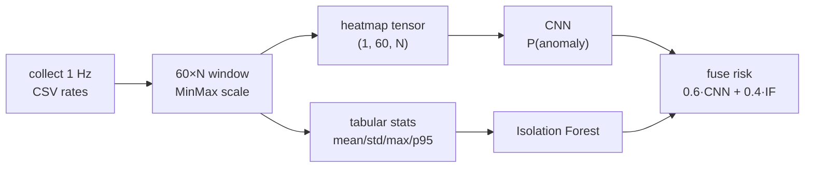

# SysSpectogram

[English](README.md) · [Русский](README_RU.md)

Self-hosted **Linux VPS / host guard**: plain-language alerts, Telegram, charts in a desktop app, optional web UI, Rust integrity agent, and optional host ML (train elsewhere — run ONNX on the VPS).

[](https://github.com/lifeqsoll/SysSpectogram/actions/workflows/ci.yml)
[](https://github.com/lifeqsoll/SysSpectogram/releases)
[](LICENSE)
[](https://www.python.org/downloads/)

[Install](#install) · [How it works](#how-it-works) · [CLI](#cli-reference) · [Telegram](#telegram-bot) · [Docker](#docker) · [FAQ](#troubleshooting)

<p align="center">
  
</p>

---

## Start here

**Installing?**

- **[I install myself → docs/INSTALL.md](docs/INSTALL.md)** (RU: [INSTALL_RU.md](docs/INSTALL_RU.md))
- **[I install with an AI agent → docs/INSTALL_WITH_AI.md](docs/INSTALL_WITH_AI.md)** — copy the prompt at the top of that file into your agent

Three ways in (short). Full paths and troubleshooting live in INSTALL.md. Geek tools stay behind **Advanced**. Release notes: **[v1.3.2](docs/RELEASE_v1.3.2.md) · [v1.3.1](docs/RELEASE_v1.3.1.md) · [v1.3.0](docs/RELEASE_v1.3.0.md)** · [v1.2.2](docs/RELEASE_v1.2.2.md) · [v1.2.1](docs/RELEASE_v1.2.1.md).

### 1. Desktop (AppImage / `.deb`)

**For most people:** download the Linux **AppImage** or **`.deb`** from the [GitHub Release](https://github.com/lifeqsoll/SysSpectogram/releases) → **Install stack** if prompted → short onboarding → protect.

Friend story: **[Friend path](docs/FRIEND.md)** · **[Simple home](docs/HOME.md)**.

From a source checkout (dev):

```bash
# helper once (polkit + systemd)
sudo scripts/install-helper.sh

cd control-center && npm install && npm run tauri dev
# complete onboarding → Home → Start protection
```

### 2. Headless VPS (SSH, no git)

```bash
# python3 + python3-venv + curl; replace tag if needed
# prefer the tagged script (not floating main); or download friend-day0.sh from the release
curl -fsSL https://raw.githubusercontent.com/lifeqsoll/SysSpectogram/v1.3.2/scripts/friend-day0.sh | bash -s -- v1.3.2
loginctl enable-linger $USER   # else protect stops on logout
```

Optional privileged helper (polkit; no local checkout):

```bash
TAG=v1.3.2
curl -fsSL -O "https://github.com/lifeqsoll/SysSpectogram/releases/download/${TAG}/install-helper-from-release.sh"
curl -fsSL -O "https://github.com/lifeqsoll/SysSpectogram/releases/download/${TAG}/install-helper-from-release.sh.minisig"
minisign -Vm install-helper-from-release.sh -P 'RWQpTS7f641bPCuKPgJc2mbA/oBkH2Yen4gN1JTofbwvyfbS6yYmLD8F'
sudo bash install-helper-from-release.sh "$TAG"
```

Full friend story: [docs/FRIEND.md](docs/FRIEND.md). Geek git Day-0: [DAY0_VPS.md](docs/DAY0_VPS.md). ONNX after training elsewhere: [TRAIN_BRIDGE.md](docs/TRAIN_BRIDGE.md).

### 3. Source install

Clone, venv, editable install — see **[Install](#install)**.

```bash
source .venv/bin/activate
# Day-0: terminal configure UI (Rich menu in THIS terminal — not a browser)
python -m sysspectogram configure
# or non-interactive:
# python -m sysspectogram configure --accept-recommended --role ssh

cd agent && cargo build --release && cd ..
python -m sysspectogram kirk trust
python -m sysspectogram supply-chain verify artifacts/real_v3
python -m sysspectogram guard --model artifacts/real_v3 --telegram --dry-run
```

### Never-ban your own IP

> [!WARNING]
> Before soft/full auto-ban, whitelist yourself so the guard cannot lock you out.
>
> ```bash
> curl -4 ifconfig.me   # e.g. 203.0.113.10
> ```
>
> Then in **Settings → Never-ban IPs** enter one or more (comma or new lines; bare IP → `/32`), e.g. `203.0.113.10` and `198.51.100.20/32` → Apply → restart guard.
> Same key: `response.never_ban_cidrs`. Details: [FRIEND.md](docs/FRIEND.md) · [HOME.md](docs/HOME.md).

### What you get

- **Control Center (simple + Advanced)** — Home, Charts, Alerts, Settings, **Fleet**; light/dark; EN/RU; first-run wizard
- **Fleet (many VPS)** — SSH + pair + device token; status / unlock-locked / Attack L2–L3 / profiles / graph ([FLEET.md](docs/FLEET.md))
- **Telegram + optional web** — Clear alerts; `/charts`; Ban/Kill after console unlock; optional fleet hub bot; web off by default
- **Guard + Rust agent** — Perimeter (SSH brute, …), FIM/process signals, timeseries charts
- **Privileged helper** — polkit allowlist for settings / service / signed bundles
- **Optional host ML** — Train on a builder PC; import ONNX weights on the VPS ([HOME.md](docs/HOME.md))

### Limitations

Same-host root can still stop services and wipe local logs. Remote alert sinks and signed manifests reduce silence/subversion; they do **not** make the tool unkillable. Optional kernel helper is off by default and often unavailable on locked-down cloud kernels.

Full list: **[Limitations and safety](#limitations-and-safety)** · [SECURITY.md](SECURITY.md).

### Docs by topic

| Topic | Links |
| --- | --- |
| Simple path | [Friend path](docs/FRIEND.md) · [Simple home](docs/HOME.md) · [Release v1.3.2](docs/RELEASE_v1.3.2.md) |
| Many VPS | [Fleet](docs/FLEET.md) · Control Center Fleet tab · `fleet` / `home pair-*` CLI |
| Geek / advanced | [Configure](docs/CONFIGURE.md) · [Day-0 CLI (git)](docs/DAY0_VPS.md) · [Cold install](docs/COLD_INSTALL.md) · [Configuration](docs/CONFIG.md) · [Control Center](docs/CONTROL_CENTER.md) |
| Defense | [Agent](docs/AGENT.md) · [Root watch](docs/ROOT_WATCH.md) · [eBPF](docs/EBPF_SETUP.md) · [Kirk](docs/KIRK.md) · [Threat model](docs/THREAT_MODEL.md) · [Supply chain](docs/SUPPLY_CHAIN.md) · [Security](SECURITY.md) |
| More | [Telegram](docs/TELEGRAM.md) · [Live web](docs/WEBAPP.md) · [Recipes](docs/RECIPES.md) · [Train bridge](docs/TRAIN_BRIDGE.md) · [Product](docs/PRODUCT_v1.0.md) · [ADRs](docs/adr/) |

---

## Table of contents

1. [How it works](#how-it-works)
2. [Requirements](#requirements)
3. [Install](#install)
4. [End-to-end workflow](#end-to-end-workflow)
5. [Best recipes](#best-recipes)
6. [Control Center](#control-center)
7. [CLI reference](#cli-reference)
8. [Telegram bot](#telegram-bot)
9. [Outputs and artifacts](#outputs-and-artifacts)
10. [Docker](#docker)
11. [systemd](#systemd)
12. [Limitations and safety](#limitations-and-safety)
13. [Troubleshooting](#troubleshooting)
14. [License](#license)
15. [Roadmap](#roadmap-note)
16. [Contributing](#contributing)

---

## How it works

### Metrics → spectrogram → CNN (the DL core)

Host telemetry is treated like a **computer-vision input**: each second is a row of rates (CPU, mem, net, disk, GPU, …); a **60×N** window becomes a single-channel heatmap (“spectrogram”) for a small **ConvNet**, while Isolation Forest sees the same window as tabular stats. Scores fuse into one host risk.




*Figure: synthetic quiet baseline vs CPU/GPU miner-like burst as the CNN would see it. Window PNG previews: [`build-dataset --png`](#build-dataset) → e.g. [normal](docs/assets/window-preview-normal.png) / [anomaly](docs/assets/window-preview-anomaly.png). Interactive demo: [GitHub Pages](https://lifeqsoll.github.io/SysSpectogram/demo/).*

| Stage | Purpose |
| --- | --- |
| `collect` | Write per-second metric rates to CSV |
| `simulate` | Local anomalous load (cpu/mem/disk/net/gpu) |
| `build-dataset` | Cut CSV into 60×N windows (train/val) |
| `train` | Fit CNN + Isolation Forest, save artifacts |
| `monitor` | Live host ML from 60s buffer |
| `analyze` | Offline CSV scoring |
| `audit` | Processes / ports / rootkit heuristics / report |
| `watch-perimeter` | Auth brute, inbound scan, egress, DNS |
| `recon` | OSINT + optional nmap |
| `guard` | Perimeter + host ML + Telegram control plane |
| `lab-nmap` | nmap only allowlisted lab targets |

Typical fused score:

`score = 0.6 * P_cnn(anomaly) + 0.4 * IsolationForest_score`

Threshold is chosen on validation to favor high recall (see `configs/default.yaml`).

### Metrics (rates, not raw counters)

Each CSV row is one second. Network/disk/context-switch fields are **per-second deltas**. Absolute counters are not used for training, so uptime does not dominate the model.

Columns include CPU (total and up to `max_cores` cores), memory/swap, page faults, network byte/packet rates, socket counts (ESTABLISHED/LISTEN sampled every N seconds), and disk I/O rates.

### Windows → “image” for the CNN

- Default window: **60 seconds** × N feature columns → shape **`(1, 60, N)`** after `window_to_tensor`
- Default stride when building a dataset: **5 seconds** (overlapping windows)
- Scaler (`MinMax`) is fit on **train** windows only and stored for inference
- Optional PNG previews: `build-dataset --png` (human view; model trains on `.npy`)

The CNN does not watch raw processes. It watches **how the whole host looks over a minute** — the same idea recruiters know from spectrograms / heatmaps in CV and audio DL.

### Ensemble

- **CNN:** small ConvNet on a single-channel 60×N heatmap tensor
- **Isolation Forest:** tabular stats over the same window (mean/std/max/p95 per feature)
- Artifacts live in one directory (`cnn.onnx` or `cnn.pt`, `iforest.ssf.npz`, `scaler.json`, `meta.json`)

### Labels for training data

You must collect **normal** and **anomaly** CSVs yourself. The tool does not invent ground truth. Use quiet desktop/server time for normal; use `simulate` / `simulations/` (or real incidents) for anomaly.

---

## Requirements

- Linux (any common distribution)
- Python 3.10+
- Optional: Rust toolchain to build `sysspectogram-agent`
- Optional eBPF: `clang`/`llvm` + kernel BTF; attach with **root** ([EBPF_SETUP.md](docs/EBPF_SETUP.md)). **Release musl agent is built with `--no-default-features` (no eBPF object).** Build agent yourself with eBPF features if you need probes.
- Optional: `notify-send` for desktop notifications
- Optional: Telegram bot (`TELEGRAM_BOT_TOKEN`, `TELEGRAM_CHAT_ID` in `.env`)
- Optional: `nmap` / `dig` (or project `tools/bin` wrappers + dnspython)
- Optional: Docker for reproducible training

---

## Install

```bash
git clone <repo-url> SysSpectogram
cd SysSpectogram
python -m venv .venv
source .venv/bin/activate

# CPU PyTorch (recommended on machines without NVIDIA CUDA):
pip install torch --index-url https://download.pytorch.org/whl/cpu
pip install -e ".[dev]"
# copy .env.example → .env and fill Telegram if needed
cp .env.example .env

python -m sysspectogram --help

# Day-0 setup UI (runs in the terminal — answers prompts with keyboard)
python -m sysspectogram configure
# headless / CI-style defaults from host probe:
# python -m sysspectogram configure --accept-recommended --role ssh
```

Editable install exposes the `sysspectogram` console script and `python -m sysspectogram`.

---

## End-to-end workflow

### 1. Collect a normal baseline

Run while the machine is used normally (browse, code, idle server):

```bash
python -m sysspectogram collect --out data/normal.csv --duration 3600
```

Longer is better for a stable profile (1–2 hours is a reasonable start).

### 2. Collect anomaly data

Terminal A:

```bash
python -m sysspectogram collect --out data/anomaly.csv --duration 1200
```

Terminal B (example CPU stress):

```bash
python -m sysspectogram simulate cpu --duration 900 --workers 2
# or:
python simulations/cpu_miner.py --duration 900
```

See [simulations/README.md](simulations/README.md) for memory, disk, and localhost network load.

### 3. Build the dataset

```bash
python -m sysspectogram build-dataset \
  --normal data/normal.csv \
  --anomaly data/anomaly.csv \
  --out dataset/ \
  --window 60 \
  --stride 5
```

<details>
<summary>Optional <code>--png</code> heatmap previews</summary>

Optional `--png` writes inferno heatmap previews next to each `.npy` (human view only; training uses tensors). Example:

```bash
python -m sysspectogram build-dataset \
  --normal data/normal.csv \
  --anomaly data/anomaly.csv \
  --out dataset/real \
  --window 60 --stride 5 \
  --png
# → dataset/real/train/anomaly/*.png  (+ .npy)
```

</details>

### 4. Train

```bash
python -m sysspectogram train --dataset dataset/ --out artifacts/ --epochs 15
```

Check printed Precision / Recall / F1 and `artifacts/meta.json`.

### 5. Run live monitoring

```bash
python -m sysspectogram monitor --model artifacts/ --interval 5 --cooldown 60
```

On anomaly: terminal alert, optional `notify-send`, top processes, optional JSONL.

### 6. Offline analysis (servers / batch)

```bash
python -m sysspectogram analyze \
  --csv data/night.csv \
  --model artifacts/ \
  --out reports/night.json
```

### 7. Quick audit (no model required)

```bash
python -m sysspectogram audit processes
python -m sysspectogram audit ports
python -m sysspectogram audit report --out reports/audit.json
```

---

## Best recipes

Full copy-paste sets: **[docs/RECIPES.md](docs/RECIPES.md)** (RU: [RECIPES_RU.md](docs/RECIPES_RU.md)).

```bash
python -m sysspectogram collect --out data/normal.csv --duration 1800
python -m sysspectogram simulate cpu --duration 900 --workers 8 &
python -m sysspectogram collect --out data/anomaly_cpu.csv --duration 900
python -m sysspectogram build-dataset \
  --normal data/normal.csv --anomaly data/anomaly_cpu.csv \
  --out dataset/real --window 60 --stride 5 \
  --max-normal-cpu-mean 25 --min-anomaly-cpu-mean 45
python -m sysspectogram train --dataset dataset/real --out artifacts/real_v3 --epochs 25
python -m sysspectogram guard --model artifacts/real_v3 --telegram --dry-run
```

---

## Control Center

Default UI: **Home / Charts / Alerts / Settings** (light + dark, EN/RU). Turn on **Advanced** in Settings for the full geek sidebar. Onboarding + ML import: [HOME.md](docs/HOME.md). Architecture: [CONTROL_CENTER.md](docs/CONTROL_CENTER.md).

```bash
# development (needs Node 20+, Rust stable, Tauri 2 system libraries)
cd control-center && npm install && npm run tauri dev

# release build (AppImage, deb)
cd control-center && npm run tauri build

# privileged helper (root service; see docs/CONTROL_CENTER.md)
cd helper && cargo build --release
```

Tagged releases publish AppImage + deb via CI. Friends: open the package → **Install stack** downloads the signed wheel/agent for the **same tag** into `~/.local/share/sysspectogram` (no git clone). See [FRIEND.md](docs/FRIEND.md).

<details>
<summary>Build the Control Center from source (developers)</summary>

Requirements: Node 20+, Rust stable, and the Tauri 2 Linux libraries (on Arch: `sudo pacman -S webkit2gtk-4.1 librsvg patchelf base-devel`; see [Tauri prerequisites](https://v2.tauri.app/start/prerequisites/)).

```bash
git clone <repo-url> SysSpectogram && cd SysSpectogram/control-center
npm install
npm run tauri build
```

Outputs:

- the binary: `control-center/src-tauri/target/release/sysspectogram-control-center`
- packages: `control-center/src-tauri/target/release/bundle/appimage/*.AppImage` and `bundle/deb/*.deb`

Run it:

```bash
./src-tauri/target/release/sysspectogram-control-center
```

The app icons are already in `control-center/src-tauri/icons/`. To replace them, put a square 1024×1024 PNG anywhere and run `npm run tauri icon path/to/icon.png`.

</details>

Root resolution: `$SYSSPECTOGRAM_HOME`, else a source checkout, else `~/.local/share/sysspectogram` (AppImage/deb), else `/var/lib/sysspectogram`. Python: `$SYSSPECTOGRAM_PYTHON`, else home `.venv`, else `/opt/sysspectogram/venv/bin/python`, else `python3`. Packaged first-run without a stack shows **Install stack**.

The UI never runs privileged commands itself. Settings changes, service control and bundle installs go through `sysspectogram-helper`, which checks each action with polkit. Dashboards read `state/timeseries.sqlite` read-only. Details: [docs/CONTROL_CENTER.md](docs/CONTROL_CENTER.md).

---

## CLI reference

Global form:

```text
python -m sysspectogram [--config PATH] [--version] <command> ...
```

| Global flag | Required | Default | Description |
| --- | --- | --- | --- |
| `--config` | no | `configs/default.yaml` | YAML with collector/window/train/monitor settings |
| `--version` | no | — | Print package version and exit |
| `-h` / `--help` | no | — | Help for the program or a subcommand |

### Commands at a glance

| Command | Purpose |
| --- | --- |
| `configure` | Day-0 TUI: probe + profile + agent + Telegram + labels |
| `collect` | Collect system metrics to CSV |
| `build-dataset` | Cut CSV logs into train/val windows |
| `train` | Train CNN + Isolation Forest ensemble |
| `export-onnx` | Export `cnn.pt` → `cnn.onnx` (needs `.[ml]`) |
| `monitor` | Realtime anomaly monitoring |
| `analyze` | Offline CSV analysis |
| `audit` | Defensive host snapshot |
| `simulate` | Generate local anomalous load |
| `watch-perimeter` | Perimeter / egress / DNS watcher |
| `recon` | OSINT + optional nmap on an IP |
| `guard` | Perimeter + host ML + Telegram control plane |
| `supply-chain` | Manifest and minisign artifact trust |
| `kirk` | Kernel integrity trust probe (IMA/SB/TPM) |
| `incidents` | Correlate alerts into incidents (`incident.v1`) |
| `lab` | Localhost-only lab runs with expected alert |
| `lab-nmap` | nmap allowlisted lab targets only |
| `scenario` | Protection scenario presets |
| `settings` | Settings schema checks / UI export |
| `timeseries` | Dashboard history store (SQLite rollups) |
| `labels` | Process label rules store |
| `feedback` | Operator feedback samples / retrain |
| `profiles` | Shareable baseline packs for Releases |
| `data` | VPS↔PC train bridge (bundle CSV / unpack) |
| `artifacts` | Push model artifacts to VPS over SSH |
| `train-agent-if` | Train Isolation Forest on agent JSONL windows |
| `role-lab` | Simulate VPS roles on PC and train baseline packs |
| `spectro` | Render a metrics spectrogram for an incident or a time |
| `web` | Live local / Telegram Mini App dashboard |
| `control` | SOAR via local guard control socket |
| `home` | Simple-home helpers (onboarding, model import, `.env`, pair-remote, warmup) |
| `fleet` | Multi-VPS registry + SSH fan-out (admin PC; see [FLEET.md](docs/FLEET.md)) |
| `eval` | Offline ML eval / `schema_version` stamp |
| `metrics` | Prometheus text (`serve` on 127.0.0.1:9108) |
| `protect` | User systemd protect service |
| `menu` | Friend interactive menu for VPS/SSH |
| `setup` | Interactive `.env` / Telegram setup (legacy) |
| `update` | Download signed wheel+agent from GitHub Releases |

<details>
<summary><code>configure</code></summary>

Interactive **terminal** setup (Rich tables + prompts). Not a web page and not a separate GUI window — open a terminal in the repo and run:

```bash
source .venv/bin/activate
python -m sysspectogram configure
```

| Flag | Description |
| --- | --- |
| `--accept-recommended` | Apply host_probe recommendations without menu |
| `--role ssh\|nginx\|…` | Role for FP label seed |
| `--prefix PATH` | Install root (default `.`) |
| `--no-seed-fp` | Skip seeding process labels |

See [docs/CONFIGURE.md](docs/CONFIGURE.md) and [docs/COLD_INSTALL.md](docs/COLD_INSTALL.md).

Related: `labels list|seed|del`, `feedback retrain-if`, `feedback status`.

</details>

<details>
<summary><code>collect</code></summary>

Write metric samples to a CSV file (append-safe; writes header if the file is new/empty).

```bash
python -m sysspectogram collect --out data/normal.csv --duration 3600
```

| Flag | Required | Default | Description |
| --- | --- | --- | --- |
| `--out` | **yes** | — | Output CSV path |
| `--duration` | no | infinite (until Ctrl+C) | Stop after this many seconds |

Uses `collector.*` from config: `interval_sec`, `max_cores`, `socket_sample_every`.

</details>

<details>
<summary><code>build-dataset</code></summary>

<a id="build-dataset"></a>

Split labeled CSVs into `train/` and `val/` windows as `.npy` tensors.

```bash
python -m sysspectogram build-dataset \
  --normal data/normal.csv \
  --anomaly data/anomaly.csv \
  --out dataset/ \
  --window 60 \
  --stride 5 \
  --png
```

| Flag | Required | Default | Description |
| --- | --- | --- | --- |
| `--normal` | **yes** | — | One or more normal CSV paths |
| `--anomaly` | **yes** | — | One or more anomaly CSV paths |
| `--out` | **yes** | — | Dataset root directory |
| `--window` | no | config `window.size` (60) | Rows per window |
| `--stride` | no | config `window.stride` (5) | Step between window starts |
| `--png` | no | off | Also write PNG previews of windows |

Writes `dataset/meta.json` and `dataset/scaler.json`.

</details>

<details>
<summary><code>train</code></summary>

Train the ensemble and write an artifacts directory.

```bash
python -m sysspectogram train --dataset dataset/ --out artifacts/ --epochs 15
```

| Flag | Required | Default | Description |
| --- | --- | --- | --- |
| `--dataset` | **yes** | — | Dataset root from `build-dataset` |
| `--out` | **yes** | — | Artifacts output directory |
| `--epochs` | no | config `train.epochs` (15) | CNN training epochs |

Other hyperparameters (`batch_size`, `lr`, fusion weights, `recall_target`, `seed`) come from config.

</details>

<details>
<summary><code>monitor</code></summary>

Realtime loop: sample every 1s into a deque of length `window_size`, infer every `--interval` seconds.

```bash
python -m sysspectogram monitor \
  --model artifacts/ \
  --interval 5 \
  --cooldown 60 \
  --jsonl-out reports/alerts.jsonl
```

| Flag | Required | Default | Description |
| --- | --- | --- | --- |
| `--model` | **yes** | — | Artifacts directory (`meta.json` + weights) |
| `--interval` | no | config `monitor.interval_sec` (5) | Seconds between inferences |
| `--cooldown` | no | config `monitor.cooldown_sec` (60) | Min seconds between alerts |
| `--jsonl-out` | no | none | Append anomaly events as JSON lines |

Stop with Ctrl+C (SIGINT/SIGTERM).

</details>

<details>
<summary><code>analyze</code></summary>

Slide windows over a CSV and report anomaly windows.

```bash
python -m sysspectogram analyze \
  --csv data/anomaly.csv \
  --model artifacts/ \
  --out reports/analyze.json
```

| Flag | Required | Default | Description |
| --- | --- | --- | --- |
| `--csv` | **yes** | — | Input metrics CSV |
| `--model` | **yes** | — | Artifacts directory |
| `--out` | no | none | JSON report path (prints summary either way) |

Stride for sliding windows comes from config `window.stride`.

</details>

<details>
<summary><code>audit</code></summary>

Defensive snapshot. Subcommand positional argument selects mode.

```bash
python -m sysspectogram audit processes
python -m sysspectogram audit ports
python -m sysspectogram audit report --out reports/audit.json
```

| Argument / flag | Required | Default | Description |
| --- | --- | --- | --- |
| `what` | **yes** | — | `processes` \| `ports` \| `report` |
| `--out` | no | stdout for `report` | JSON path when `what=report` |

- `processes` — top CPU/mem processes + light heuristics  
- `ports` — LISTEN / ESTABLISHED from `/proc/net/tcp{,6}` (process names when permitted)  
- `report` — combined JSON  

Extras:

```bash
python -m sysspectogram audit rootkit
python -m sysspectogram audit report --out reports/audit.json
```

`what`: `processes` \| `ports` \| `report` \| `rootkit`.

</details>

<details>
<summary><code>simulate</code></summary>

Local load generators for anomaly labeling. Affects **this host only**. Network mode uses `127.0.0.1` only.

```bash
python -m sysspectogram simulate cpu --duration 900 --workers 8
python -m sysspectogram simulate mem --duration 90 --mb 8192
python -m sysspectogram simulate disk --duration 300 --block-mb 32
python -m sysspectogram simulate net --duration 900 --rate 80
python -m sysspectogram simulate gpu --duration 60 --gpu-size 4096
```

| Argument / flag | Required | Default | Description |
| --- | --- | --- | --- |
| `kind` | **yes** | — | `cpu` \| `mem` \| `disk` \| `net` \| `gpu` |
| `--duration` | no | 60 | Seconds to run |
| `--workers` | no | ~half of CPUs | Process count for `cpu` |
| `--mb` | no | 512 | Megabytes for `mem` |
| `--block-mb` | no | 32 | Block size for `disk` |
| `--rate` | no | 80 | Localhost connects/s for `net` |
| `--gpu-size` | no | 2048 | Matmul size for `gpu` (needs CUDA torch) |

Also: `simulations/` and `simulations/intrusion/` (lab).

</details>

<details>
<summary><code>watch-perimeter</code></summary>

```bash
python -m sysspectogram watch-perimeter --duration 3600 --jsonl-out reports/perimeter.jsonl
```

Flags: `--poll`, `--denylist`, `--no-recon`.

</details>

<details>
<summary><code>recon</code></summary>

```bash
python -m sysspectogram recon 198.51.100.20
python -m sysspectogram recon 198.51.100.20 --no-nmap --no-ct
```

</details>

<details>
<summary><code>guard</code></summary>

```bash
python -m sysspectogram guard --model artifacts/real_v3 --telegram --dry-run \
  --jsonl-out reports/guard.jsonl
```

| Flag | Description |
| --- | --- |
| `--model` | Artifacts dir (optional; without it host ML is off) |
| `--telegram` | Long-poll bot + alerts |
| `--dry-run` | Do not apply nft/kill |
| `--duration` | Optional finite run |
| `--jsonl-out` | Alert stream |

</details>

<details>
<summary><code>incidents</code></summary>

```bash
python -m sysspectogram incidents list --window 300
python -m sysspectogram incidents show <id>
python -m sysspectogram incidents report <id> --format html --out reports/incident.html
```

Correlates `reports/alerts.jsonl`, `agent.jsonl` and `perimeter.jsonl` into `incident.v1` records in `reports/incidents.jsonl`.

</details>

<details>
<summary><code>lab</code></summary>

```bash
python -m sysspectogram lab list --json
python -m sysspectogram lab run sim-cpu
```

Registered localhost-only lab runs. Each one states the alert it should produce, and the Control Center checks the reports for it. Runs that use intrusion scripts ask for consent first.

</details>

<details>
<summary><code>scenario</code></summary>

```bash
python -m sysspectogram scenario list
python -m sysspectogram scenario show hardened-observe --lang en
```

Protection presets from `configs/scenarios/`. `show` prints each change with its explanation. Applying a preset is done in the Control Center.

</details>

<details>
<summary><code>settings</code></summary>

```bash
python -m sysspectogram settings export    # JSON for the UI: schema, values, scenarios
python -m sysspectogram settings check     # CI: schema, i18n, defaults, scenarios
```

</details>

<details>
<summary><code>timeseries</code></summary>

```bash
python -m sysspectogram timeseries query host_risk --range 6h
```

Points from `state/timeseries.sqlite`. Ranges: `1h`, `6h`, `12h`, `24h`, `7d`, `30d`.

</details>

<details>
<summary><code>lab-nmap</code></summary>

```bash
python -m sysspectogram lab-nmap 127.0.0.1 --lab
```

Targets must be in `lab.nmap_targets` (config) or localhost.

</details>

---

## Telegram bot

Full reference: **[docs/TELEGRAM.md](docs/TELEGRAM.md)**.

<details>
<summary>Telegram <code>.env</code> and <code>guard --telegram</code></summary>

```bash
# .env
TELEGRAM_BOT_TOKEN=...
TELEGRAM_CHAT_ID=...

python -m sysspectogram guard --model artifacts/real_v3 --telegram --dry-run
```

</details>

Phone commands mirror CLI ops: `/audit` `/panel` `/score` `/simulate` `/collect` `/analyze` `/recon` `/ban` `/ports` `/processes` `/rootkit` `/recipes` …  
Long jobs (`train`, `build-dataset`, `monitor`, `guard`) stay on the host; `/recipes` prints best flags.

Alerts send a **dual heatmap** (metrics + top-PID CPU% over time) plus pattern labels and confirm buttons.

---

## Outputs and artifacts

| Path | Contents |
| --- | --- |
| `data/*.csv` | Raw metric time series |
| `dataset/train/{normal,anomaly}/*.npy` | Scaled windows |
| `dataset/val/...` | Validation windows |
| `dataset/scaler.json` | Fitted scaler (pickle-free) |
| `dataset/meta.json` | Columns, window, counts |
| `artifacts/cnn.pt` | CNN weights + shape metadata (builder / torch_ml) |
| `artifacts/cnn.onnx` | Recommended VPS CNN |
| `artifacts/iforest.ssf.npz` | Isolation Forest (safe) |
| `artifacts/scaler.json` | Copy of scaler for inference |
| `artifacts/meta.json` | Threshold, fusion weights, metrics, columns |
| `reports/*.json` | Analyze / audit reports |
| `reports/*.jsonl` | Streaming alerts from `monitor` |

---

## Docker

**Warning:** Docker is for **train** / **analyze** only with mounted volumes. Do **not** run `monitor` / `guard` in a plain container expecting host IDS fidelity — you see cgroup metrics and the container network namespace, not the bare-metal host, unless you deliberately pass `--pid=host --net=host` (and accept the security trade-offs). Prefer a native systemd install for live detection.

<details>
<summary>Docker build and train example</summary>

```bash
docker build -t sysspectogram .
docker run --rm \
  -v "$PWD/dataset:/dataset" \
  -v "$PWD/artifacts:/artifacts" \
  sysspectogram train --dataset /dataset --out /artifacts
```

</details>

The image installs CPU PyTorch by default.

---

## systemd

- Monitor: [scripts/systemd/sysspectogram-monitor.service](scripts/systemd/sysspectogram-monitor.service)
- Guard + Telegram: [scripts/systemd/sysspectogram-guard.service](scripts/systemd/sysspectogram-guard.service)
- Agent: [scripts/systemd/sysspectogram-agent.service](scripts/systemd/sysspectogram-agent.service) (for eBPF, run as root / see [EBPF_SETUP.md](docs/EBPF_SETUP.md))

<details>
<summary>Secrets, enable, hardening notes</summary>

Put secrets in `/opt/sysspectogram/.env` (or `/etc/sysspectogram.env`); units use `EnvironmentFile=-…`. Point `--model` at artifacts, then `systemctl enable --now …`. Helper: `scripts/install.sh`. Units ship with basic hardening (`ProtectSystem`, `PrivateTmp`, …); relax if you need live nft without `--dry-run`.

</details>

---

## Limitations and safety

Same section linked from [Start here → Limitations](#limitations).

- Model quality depends on **your** labeled CSVs. A model trained on a laptop will not match a busy database VPS.  
- Does not detect kernel rootkits or signed malware by name. Userspace `/proc` can be lied to by advanced LKMs; eBPF `execve`/`openat` reduces the blind spot but is not complete coverage.  
- Simulations must stay on the local machine / localhost. Do not aim them at third-party networks.  
- `audit` heuristics are best-effort hints, not proof.  
- Desktop notifications require a working Freedesktop notification service; headless hosts rely on terminal/JSONL.  
- **Telegram / Mini App:** treat `.env` as highly sensitive. Console unlock (`/unlock`) blocks control actions if the token leaks, but **does not** protect against an attacker who also has host console access. Keep `require_console_unlock: true`, short `unlock_ttl_sec`, and never put the unlock code in chat history on purpose.  
- Agent Unix socket: prefer `$XDG_RUNTIME_DIR` (mode `0600`); do not expose the web port on `0.0.0.0` without a reverse proxy + auth.  

---

## Troubleshooting

| Problem | Solution |
| --- | --- |
| `build-dataset` fails with no windows | CSV shorter than `--window`; collect longer or reduce window |
| Poor F1 after train | Class imbalance, too little normal/anomaly time, or identical loads in both CSVs |
| `monitor` never alerts | Score below threshold; verify with `analyze` on a known anomaly CSV |
| `monitor` alert spam | Increase `--cooldown` |
| Import / torch errors | Reinstall CPU torch from the official CPU index URL |
| Empty socket fields | Permissions or `/proc/net/tcp` unavailable in the environment |

Run unit tests after install:

```bash
pytest -q
```

---

## License

MIT. See [LICENSE](LICENSE).

## Roadmap note

**v1.3.0** — Security hardening (signed updates, auth/web/pair/kirk). Breaking vs 1.2.x. See [RELEASE_v1.3.0.md](docs/RELEASE_v1.3.0.md), [FLEET.md](docs/FLEET.md), [FRIEND.md](docs/FRIEND.md). Do **not** use **v1.2.0**.

## Contributing

PRs welcome. For security issues, follow [SECURITY.md](SECURITY.md).
