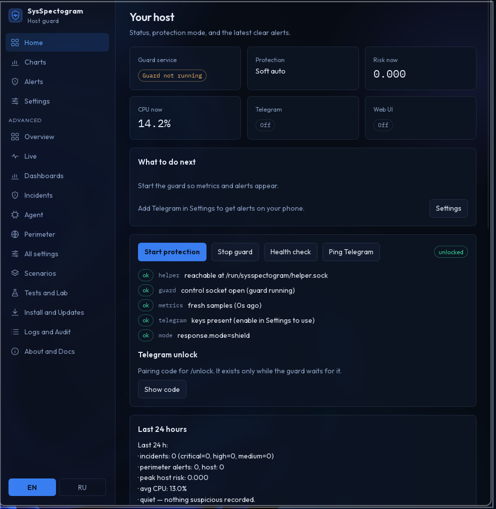
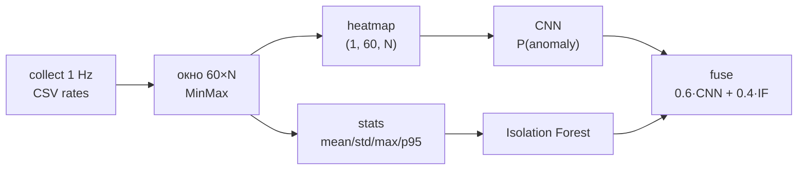
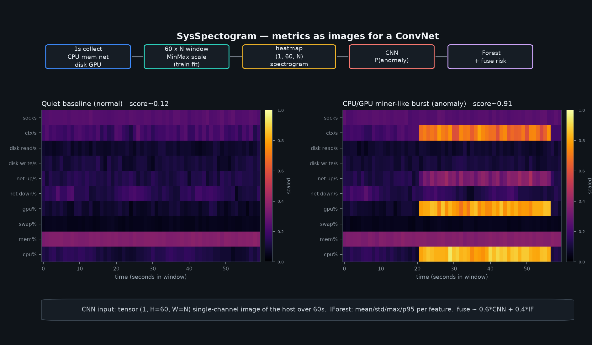

# SysSpectogram

[English](README.md) · [Русский](README_RU.md)

Самостоятельная **защита Linux VPS и хоста**: понятные алерты, Telegram, графики в десктоп-приложении, по желанию — веб, Rust-агент целостности и host ML (учите модель на другой машине, на VPS крутите ONNX).

[](https://github.com/lifeqsoll/SysSpectogram/actions/workflows/ci.yml)
[](https://github.com/lifeqsoll/SysSpectogram/releases)
[](LICENSE)
[](https://www.python.org/downloads/)

[Установка](#установка) · [Как устроено](#как-устроено) · [CLI](#справочник-cli) · [Telegram](#telegram) · [Docker](#docker) · [FAQ](#типичные-проблемы)

**Демо:** [lifeqsoll.github.io/SysSpectogram/demo](https://lifeqsoll.github.io/SysSpectogram/demo/)

<p align="center">
  
</p>

---

## С чего начать

**Установка?**

- **[Ставлю сам → docs/INSTALL_RU.md](docs/INSTALL_RU.md)** (EN: [INSTALL.md](docs/INSTALL.md))
- **[Ставлю с ИИ-агентом → docs/INSTALL_WITH_AI.md](docs/INSTALL_WITH_AI.md)** — скопируй промпт в начале файла в чат с агентом

Краткие три пути ниже; полный гайд и FAQ — в INSTALL. Всё «для гиков» спрятано за **Advanced**. Релизы: **[v1.3.2](docs/RELEASE_v1.3.2.md) · [v1.3.1](docs/RELEASE_v1.3.1.md) · [v1.3.0](docs/RELEASE_v1.3.0.md)** · [v1.2.2](docs/RELEASE_v1.2.2.md) · [v1.2.1](docs/RELEASE_v1.2.1.md).

### 1. Десктоп (AppImage / `.deb`)

**Самый простой путь:** скачайте Linux **AppImage** или **`.deb`** с [релизов GitHub](https://github.com/lifeqsoll/SysSpectogram/releases) → если попросит — **Установить стек** → короткий мастер настройки → включите защиту.

Гайды: **[простая установка](docs/FRIEND.md)** · **[домашний экран](docs/HOME.md)**.

Из исходников (разработка):

```bash
sudo scripts/install-helper.sh
cd control-center && npm install && npm run tauri dev
# мастер → Главная → Включить защиту
```

### 2. VPS по SSH (без git на сервере)

Полный гайд: **[docs/INSTALL_RU.md](docs/INSTALL_RU.md)**. Кратко (только ассеты релиза + minisign — не pipe raw git):

```bash
TAG=<LATEST_TAG>   # со страницы releases/latest
curl -fsSL -O "https://github.com/lifeqsoll/SysSpectogram/releases/download/${TAG}/friend-day0.sh"
curl -fsSL -O "https://github.com/lifeqsoll/SysSpectogram/releases/download/${TAG}/friend-day0.sh.minisig"
minisign -Vm friend-day0.sh -P 'RWQpTS7f641bPCuKPgJc2mbA/oBkH2Yen4gN1JTofbwvyfbS6yYmLD8F'
bash friend-day0.sh "$TAG"
loginctl enable-linger $USER   # иначе защита остановится после выхода из SSH
```

Отдельный привилегированный helper (polkit), если нужен:

```bash
TAG=<LATEST_TAG>
curl -fsSL -O "https://github.com/lifeqsoll/SysSpectogram/releases/download/${TAG}/install-helper-from-release.sh"
curl -fsSL -O "https://github.com/lifeqsoll/SysSpectogram/releases/download/${TAG}/install-helper-from-release.sh.minisig"
minisign -Vm install-helper-from-release.sh -P 'RWQpTS7f641bPCuKPgJc2mbA/oBkH2Yen4gN1JTofbwvyfbS6yYmLD8F'
sudo bash install-helper-from-release.sh "$TAG"
```

Подробнее: [FRIEND.md](docs/FRIEND.md). Установка через git: [DAY0_VPS.md](docs/DAY0_VPS.md). ONNX после обучения на другой машине: [TRAIN_BRIDGE.md](docs/TRAIN_BRIDGE.md).

### 3. Из исходников

Клонируйте репозиторий, сделайте venv и editable-установку — см. **[Установка](#установка)**.

```bash
source .venv/bin/activate
python -m sysspectogram configure --accept-recommended --role ssh
cd agent && cargo build --release && cd ..
python -m sysspectogram guard --telegram --dry-run
```

### Свой IP в never-ban

> [!WARNING]
> Перед мягким или полным автобаном добавьте себя в белый список — иначе можно отрезать собственный доступ.
>
> ```bash
> curl -4 ifconfig.me   # например 203.0.113.10
> ```
>
> В **Настройки → Never-ban IP** укажите один или несколько адресов (через запятую или с новой строки; голый IP станет `/32`), например `203.0.113.10` и `198.51.100.20/32` → **Применить** → перезапустите guard.
> Ключ конфига: `response.never_ban_cidrs`. Подробнее: [FRIEND.md](docs/FRIEND.md) · [HOME.md](docs/HOME.md).

### Что внутри

- **Control Center** — простой режим и Advanced: главная, графики, алерты, настройки, вкладка **Флот**; светлая/тёмная тема; EN/RU; мастер первого запуска
- **Флот (несколько VPS)** — с админского ПК: SSH, одноразовый pair-код и device token; статус, массовый unlock, Attack L2–L3, профили и граф зависимостей ([FLEET.md](docs/FLEET.md))
- **Telegram** (и по желанию web) — понятные алерты, `/charts`, Ban/Kill после unlock; для флота — отдельный hub-бот; web по умолчанию выключен
- **Guard и Rust-агент** — периметр (брутфорс SSH и др.), FIM/процессы, графики по timeseries
- **Helper** — polkit: настройки, служба, подписанные bundle
- **Host ML по желанию** — обучение на builder-ПК, на VPS — импорт ONNX ([HOME.md](docs/HOME.md))

### Ограничения

Root на том же хосте может остановить сервис и стереть локальные логи. Удалённые sinks и подписи манифестов усложняют «тихую» подмену, но **не** делают инструмент неуязвимым.

Полный список: **[Ограничения и безопасность](#ограничения-и-безопасность)** · [SECURITY.md](SECURITY.md).

### Документы по темам

| Тема | Ссылки |
| --- | --- |
| Простой путь | [Установка без гиковщины](docs/FRIEND.md) · [Домашний экран](docs/HOME.md) · [Релиз v1.3.2](docs/RELEASE_v1.3.2.md) |
| Несколько VPS | [Флот](docs/FLEET.md) · вкладка Флот в Control Center · CLI `fleet` / `home pair-*` |
| Для гиков | [Configure](docs/CONFIGURE.md) · [Day-0 через git](docs/DAY0_VPS.md) · [Холодная установка](docs/COLD_INSTALL.md) · [Конфиг](docs/CONFIG_RU.md) · [Control Center](docs/CONTROL_CENTER.md) |
| Защита | [Agent](docs/AGENT.md) · [Root watch](docs/ROOT_WATCH.md) · [eBPF](docs/EBPF_SETUP.md) · [Kirk](docs/KIRK.md) · [Threat model](docs/THREAT_MODEL.md) · [Supply chain](docs/SUPPLY_CHAIN.md) · [Security](SECURITY.md) |
| Ещё | [Telegram](docs/TELEGRAM_RU.md) · [Веб](docs/WEBAPP_RU.md) · [Рецепты](docs/RECIPES_RU.md) · [Train bridge](docs/TRAIN_BRIDGE.md) · [Product](docs/PRODUCT_v1.0.md) · [ADR](docs/adr/) |

---

## Содержание

1. [Как устроено](#как-устроено)
2. [Требования](#требования)
3. [Установка](#установка)
4. [Полный цикл](#полный-цикл)
5. [Сценарии](#сценарии)
6. [Control Center](#control-center)
7. [Справочник CLI](#справочник-cli)
8. [Telegram](#telegram)
9. [Артефакты и файлы](#артефакты-и-файлы)
10. [Docker](#docker)
11. [systemd](#systemd)
12. [Ограничения и безопасность](#ограничения-и-безопасность)
13. [Типичные проблемы](#типичные-проблемы)
14. [Лицензия](#лицензия)
15. [О версиях](#о-версиях)
16. [Участие](#участие)

---

## Как устроено

### Метрики → спектрограмма → CNN

Телеметрия хоста подаётся как **вход для computer vision**: каждую секунду — строка rates (CPU, память, сеть, диск, GPU…); окно **60×N** превращается в одноканальный heatmap («спектрограмму») для небольшой **ConvNet**, а Isolation Forest смотрит на то же окно как на таблицу статистик. Оба скора сливаются в один host risk.





*На картинке: спокойный baseline и всплеск «как у майнера» — так CNN видит минуту жизни хоста. Превью окон: [`build-dataset --png`](#build-dataset) → [норма](docs/assets/window-preview-normal.png) / [аномалия](docs/assets/window-preview-anomaly.png). Интерактивное демо: [GitHub Pages](https://lifeqsoll.github.io/SysSpectogram/demo/).*

| Этап | Зачем |
| --- | --- |
| `collect` | Пишет поминутные (посекундные) rates в CSV |
| `simulate` / `simulations/` | Локальная нагрузка cpu/mem/disk/net/gpu |
| `build-dataset` | Режет CSV на окна 60×N (train/val) |
| `train` | Учит CNN + Isolation Forest, кладёт артефакты |
| `monitor` | Живой детект по буферу последних 60 секунд |
| `watch-perimeter` | Брутфорс auth, inbound scan, egress denylist, DNS |
| `recon` | OSINT и по желанию nmap по IP |
| `guard` | Периметр + host ML + Telegram |
| `lab-nmap` | nmap только по разрешённым lab-целям |
| `analyze` | Офлайн-прогон CSV уже обученной моделью |
| `audit` | Процессы / порты / rootkit-эвристики / отчёт |

Формула скора по умолчанию:

`score = 0.6 * P_cnn(anomaly) + 0.4 * IsolationForest_score`

Порог на валидации подбирается с упором на высокий Recall (см. `configs/default.yaml`).

### Метрики: rates, не сырые счётчики

Каждая строка CSV — одна секунда. Сеть, диск, context switches — это **дельты в секунду**. Абсолютные счётчики в обучение не идут: иначе uptime забьёт сигнал аномалии.

В колонках: CPU (общий и до `max_cores` ядер), память/swap, page faults, сетевые байты и пакеты в секунду, число сокетов ESTABLISHED/LISTEN (опрос раз в N секунд), дисковый I/O.

### Окна → «картинка» для CNN

- Окно по умолчанию: **60 секунд** × N признаков → тензор **`(1, 60, N)`** после `window_to_tensor`
- Шаг при сборке датасета: **5 секунд** (окна перекрываются)
- `MinMax`-скейлер учится **только на train** и сохраняется для inference
- Опциональные PNG: `build-dataset --png` (для глаз; модель учится на `.npy`)

CNN не смотрит сырые процессы. Она смотрит, **как выглядит весь хост за минуту** — та же идея, что спектрограммы и heatmap в CV и audio DL.

### Ансамбль

- **CNN** — маленькая сеть по одноканальному тензору 60×N
- **Isolation Forest** — статистики по тому же окну (mean/std/max/p95)
- Всё в одной папке: `cnn.onnx` или `cnn.pt`, `iforest.ssf.npz`, `scaler.json`, `meta.json`

### Разметка

Нужны отдельные CSV **normal** и **anomaly**. Инструмент сам разметку не выдумывает. Норму собирайте в обычной работе; аномалию — через `simulate` / `simulations/` или реальные инциденты.

---

## Требования

- Linux (любой обычный дистрибутив)
- Python 3.10+
- По желанию: Rust toolchain для сборки `sysspectogram-agent`
- По желанию eBPF: `clang`/`llvm` + BTF ядра; attach от **root** ([EBPF_SETUP.md](docs/EBPF_SETUP.md)). **Релизный musl-агент собирается с `--no-default-features` (без eBPF).** Нужны пробы — соберите agent сами с eBPF-фичами.
- По желанию: `notify-send` для десктоп-уведомлений
- По желанию: Docker для воспроизводимого обучения
- `stress-ng` не обязателен — встроенных симуляторов хватает

---

## Установка

```bash
git clone <repo-url> SysSpectogram
cd SysSpectogram
python -m venv .venv
source .venv/bin/activate

# CPU-сборка PyTorch (удобно без NVIDIA CUDA):
pip install torch --index-url https://download.pytorch.org/whl/cpu
pip install -e ".[dev]"

python -m sysspectogram --help

# Day-0: настройка в этом терминале (клавиатура, не браузер)
python -m sysspectogram configure
# без меню — сразу рекомендации probe:
# python -m sysspectogram configure --accept-recommended --role ssh
```

После установки доступны `sysspectogram` и `python -m sysspectogram`.

---

## Полный цикл

### 1. Нормальный профиль

```bash
python -m sysspectogram collect --out data/normal.csv --duration 3600
```

Для устойчивого профиля лучше 1–2 часа обычной нагрузки.

### 2. Аномальный профиль

Терминал A:

```bash
python -m sysspectogram collect --out data/anomaly.csv --duration 1200
```

Терминал B:

```bash
python -m sysspectogram simulate cpu --duration 900 --workers 2
# или:
python simulations/cpu_miner.py --duration 900
```

Память, диск и localhost-сеть: [simulations/README.md](simulations/README.md).

### 3. Датасет

```bash
python -m sysspectogram build-dataset \
  --normal data/normal.csv \
  --anomaly data/anomaly.csv \
  --out dataset/ \
  --window 60 \
  --stride 5
```

<details>
<summary>Превью PNG (<code>--png</code>)</summary>

Флаг `--png` пишет inferno-heatmap рядом с каждым `.npy` (только превью; обучение идёт по тензорам):

```bash
python -m sysspectogram build-dataset \
  --normal data/normal.csv \
  --anomaly data/anomaly.csv \
  --out dataset/real \
  --window 60 --stride 5 \
  --png
# → dataset/real/train/anomaly/*.png  (+ .npy)
```

</details>

### 4. Обучение

```bash
python -m sysspectogram train --dataset dataset/ --out artifacts/ --epochs 15
```

Смотрите Precision / Recall / F1 и `artifacts/meta.json`.

### 5. В реальном времени

```bash
python -m sysspectogram monitor --model artifacts/ --interval 5 --cooldown 60
```

При аномалии: вывод в терминал, по желанию `notify-send`, топ процессов, опционально JSONL.

### 6. Офлайн на сервере

```bash
python -m sysspectogram analyze \
  --csv data/night.csv \
  --model artifacts/ \
  --out reports/night.json
```

### 7. Аудит без модели

```bash
python -m sysspectogram audit processes
python -m sysspectogram audit ports
python -m sysspectogram audit report --out reports/audit.json
```

---

## Сценарии

### Домашняя/рабочая станция и имитация майнера по CPU

1. Час `collect` нормы.  
2. `collect` аномалии параллельно с `simulate cpu`.  
3. `build-dataset` → `train` → `monitor`.  

**Зачем:** ловить устойчивые аномальные паттерны CPU и сразу видеть PID в топе.

### VPS: ночной лог без интерактива

1. Таймер: `collect --duration 86400`.  
2. Утром: `analyze` по CSV с готовыми `artifacts/`.  

**Зачем:** ретроспектива без постоянного GUI.

### Быстрый разбор «что сейчас на хосте»

```bash
python -m sysspectogram audit report --out reports/triage.json
```

**Зачем:** инвентаризация нагрузки и портов. Дополняет `monitor`, не заменяет его.

### Смена роли сервера

После смены сервисов соберите новый normal CSV и переобучите модель. Старые артефакты описывают старую «норму».

### Готовые рецепты

Полный набор: **[docs/RECIPES_RU.md](docs/RECIPES_RU.md)**.

```bash
python -m sysspectogram collect --out data/normal.csv --duration 1800
python -m sysspectogram simulate cpu --duration 900 --workers 8 &
python -m sysspectogram collect --out data/anomaly_cpu.csv --duration 900
python -m sysspectogram build-dataset \
  --normal data/normal.csv --anomaly data/anomaly_cpu.csv \
  --out dataset/real --window 60 --stride 5 \
  --max-normal-cpu-mean 25 --min-anomaly-cpu-mean 45
python -m sysspectogram train --dataset dataset/real --out artifacts/real_v3 --epochs 25
python -m sysspectogram guard --model artifacts/real_v3 --telegram --dry-run
```

---

## Control Center

По умолчанию видны **Главная / Графики / Алерты / Настройки** (и **Флот**). Светлая и тёмная тема, EN/RU. Переключатель **Advanced** открывает полный гик-сайдбар. Онбординг и ML: [HOME.md](docs/HOME.md). Архитектура: [CONTROL_CENTER.md](docs/CONTROL_CENTER.md).

<details>
<summary>Сборка Control Center из исходников</summary>

```bash
# нужны Node 20+, Rust stable, системные библиотеки Tauri 2
cd control-center && npm install && npm run tauri dev

# релизная сборка (AppImage, deb)
cd control-center && npm run tauri build

# привилегированный helper (root-сервис; см. docs/CONTROL_CENTER.md)
cd helper && cargo build --release
```

</details>

На тегированных релизах CI выкладывает AppImage и deb. Простой путь: открыть пакет → **Установить стек** скачает подписанный wheel и agent **того же тега** в `~/.local/share/sysspectogram` (без `git clone`). См. [FRIEND.md](docs/FRIEND.md).

Сам интерфейс не выполняет привилегированных команд. Настройки, управление службой и установка bundle идут через `sysspectogram-helper` и polkit. Дашборды читают `state/timeseries.sqlite` только на чтение. Подробнее: [CONTROL_CENTER.md](docs/CONTROL_CENTER.md).

---

## Справочник CLI

Общий вид:

```text
python -m sysspectogram [--config PATH] [--version] <command> ...
```

| Глобальный флаг | Обязателен | По умолчанию | Описание |
| --- | --- | --- | --- |
| `--config` | нет | `configs/default.yaml` | YAML: collector / window / train / monitor |
| `--version` | нет | — | Версия пакета |
| `-h` / `--help` | нет | — | Справка по программе или подкоманде |

### Команды кратко

| Команда | Назначение |
| --- | --- |
| `configure` | Первичная настройка в терминале: probe, профиль, агент, Telegram, метки |
| `collect` | Сбор системных метрик в CSV |
| `build-dataset` | Нарезка CSV на окна train/val |
| `train` | Обучение CNN + Isolation Forest |
| `export-onnx` | Экспорт `cnn.pt` → `cnn.onnx` (нужен extras `.[ml]`) |
| `monitor` | Мониторинг аномалий в реальном времени |
| `analyze` | Офлайн-разбор CSV |
| `audit` | Снимок хоста без модели |
| `simulate` | Локальная аномальная нагрузка |
| `watch-perimeter` | Периметр / egress / DNS |
| `recon` | OSINT и опционально nmap по IP |
| `guard` | Периметр + host ML + Telegram |
| `supply-chain` | Проверка манифеста и minisign |
| `kirk` | Целостность ядра (IMA / Secure Boot / TPM) |
| `incidents` | Склейка алертов в инциденты (`incident.v1`) |
| `lab` | Лабораторные сценарии только на localhost |
| `lab-nmap` | nmap только по разрешённым lab-целям |
| `scenario` | Пресеты защиты |
| `settings` | Проверка схемы / экспорт для UI |
| `timeseries` | История дашборда (SQLite) |
| `labels` | Правила меток процессов |
| `feedback` | Обратная связь оператора / дообучение |
| `profiles` | Пакеты baseline для Releases |
| `data` | Мост VPS↔ПК (bundle CSV / unpack) |
| `artifacts` | Выгрузка модели на VPS по SSH |
| `train-agent-if` | Isolation Forest по agent JSONL |
| `role-lab` | Симуляция ролей VPS на ПК и baseline-пакеты |
| `spectro` | Рендер спектрограммы метрик |
| `web` | Локальный дашборд / Telegram Mini App |
| `control` | SOAR через локальный control.sock guard’а |
| `home` | Простые хелперы: онбординг, модель, `.env`, pair, warmup |
| `fleet` | Несколько VPS с админ-ПК ([FLEET.md](docs/FLEET.md)) |
| `eval` | Офлайн ML-eval / stamp `schema_version` |
| `metrics` | Prometheus text (`serve` на 127.0.0.1:9108) |
| `protect` | Пользовательский systemd-сервис защиты |
| `menu` | Интерактивное меню для VPS/SSH |
| `setup` | Интерактивный `.env` / Telegram (устаревшее) |
| `update` | Скачать подписанный wheel+agent с GitHub Releases |

<details>
<summary><code>configure</code></summary>

Настройка **в терминале** (таблицы Rich и вопросы). Это не веб и не отдельное окно GUI — откройте терминал в репозитории:

```bash
source .venv/bin/activate
python -m sysspectogram configure
```

| Флаг | Описание |
| --- | --- |
| `--accept-recommended` | Применить рекомендации host_probe без меню |
| `--role ssh\|nginx\|…` | Роль для FP-меток процессов |
| `--prefix PATH` | Корень установки (по умолчанию `.`) |
| `--no-seed-fp` | Не засевать process labels |

См. [CONFIGURE.md](docs/CONFIGURE.md), [COLD_INSTALL.md](docs/COLD_INSTALL.md).

Также: `labels list|seed|del`, `feedback retrain-if`, `feedback status`.

</details>

<details>
<summary><code>collect</code></summary>

Пишет метрики в CSV (дописывает; заголовок — если файл новый или пустой).

```bash
python -m sysspectogram collect --out data/normal.csv --duration 3600
```

| Флаг | Обязателен | По умолчанию | Описание |
| --- | --- | --- | --- |
| `--out` | **да** | — | Путь к CSV |
| `--duration` | нет | пока не Ctrl+C | Останов через N секунд |

Из конфига: `collector.interval_sec`, `max_cores`, `socket_sample_every`.

</details>

<details>
<summary><code>build-dataset</code></summary>

<a id="build-dataset"></a>

Нарезка CSV в `train/` и `val/` как `.npy`.

```bash
python -m sysspectogram build-dataset \
  --normal data/normal.csv \
  --anomaly data/anomaly.csv \
  --out dataset/ \
  --window 60 \
  --stride 5 \
  --png
```

| Флаг | Обязателен | По умолчанию | Описание |
| --- | --- | --- | --- |
| `--normal` | **да** | — | Один или несколько CSV нормы |
| `--anomaly` | **да** | — | Один или несколько CSV аномалии |
| `--out` | **да** | — | Корень датасета |
| `--window` | нет | `window.size` (60) | Число строк в окне |
| `--stride` | нет | `window.stride` (5) | Шаг между окнами |
| `--png` | нет | выкл. | PNG-heatmap рядом с каждым `.npy` (превью) |

В корне датасета появятся `meta.json` и `scaler.json`.

</details>

<details>
<summary><code>train</code></summary>

Обучение ансамбля.

```bash
python -m sysspectogram train --dataset dataset/ --out artifacts/ --epochs 15
```

| Флаг | Обязателен | По умолчанию | Описание |
| --- | --- | --- | --- |
| `--dataset` | **да** | — | Корень датасета |
| `--out` | **да** | — | Каталог артефактов |
| `--epochs` | нет | `train.epochs` (15) | Эпохи CNN |

Остальные гиперпараметры — из YAML (`batch_size`, `lr`, веса fusion, `recall_target`, `seed`).

</details>

<details>
<summary><code>monitor</code></summary>

Раз в секунду сэмпл в deque на `window_size`, inference каждые `--interval` секунд.

```bash
python -m sysspectogram monitor \
  --model artifacts/ \
  --interval 5 \
  --cooldown 60 \
  --jsonl-out reports/alerts.jsonl
```

| Флаг | Обязателен | По умолчанию | Описание |
| --- | --- | --- | --- |
| `--model` | **да** | — | Каталог артефактов |
| `--interval` | нет | `monitor.interval_sec` (5) | Пауза между inference |
| `--cooldown` | нет | `monitor.cooldown_sec` (60) | Мин. пауза между алертами |
| `--jsonl-out` | нет | нет | JSONL с событиями аномалий |

Останов: Ctrl+C.

</details>

<details>
<summary><code>analyze</code></summary>

Скользящие окна по CSV.

```bash
python -m sysspectogram analyze \
  --csv data/anomaly.csv \
  --model artifacts/ \
  --out reports/analyze.json
```

| Флаг | Обязателен | По умолчанию | Описание |
| --- | --- | --- | --- |
| `--csv` | **да** | — | Входной CSV |
| `--model` | **да** | — | Артефакты |
| `--out` | нет | нет | JSON-отчёт (сводка печатается всегда) |

Шаг окон — `window.stride` из конфига.

</details>

<details>
<summary><code>audit</code></summary>

Снимок хоста. Режим задаётся позиционным аргументом.

```bash
python -m sysspectogram audit processes
python -m sysspectogram audit ports
python -m sysspectogram audit rootkit
python -m sysspectogram audit report --out reports/audit.json
```

| Аргумент / флаг | Обязателен | По умолчанию | Описание |
| --- | --- | --- | --- |
| `what` | **да** | — | `processes` \| `ports` \| `report` |
| `--out` | нет | stdout для `report` | Путь JSON при `report` |

</details>

<details>
<summary><code>simulate</code></summary>

Локальные генераторы нагрузки. Сеть — только `127.0.0.1`.

```bash
python -m sysspectogram simulate cpu --duration 900 --workers 2
python -m sysspectogram simulate mem --duration 300 --mb 512
python -m sysspectogram simulate disk --duration 300 --block-mb 32
python -m sysspectogram simulate net --duration 900 --rate 80
python -m sysspectogram simulate gpu --duration 60 --gpu-size 4096
```

| Аргумент / флаг | Обязателен | По умолчанию | Описание |
| --- | --- | --- | --- |
| `kind` | **да** | — | `cpu` \| `mem` \| `disk` \| `net` \| `gpu` |
| `--duration` | нет | 60 | Длительность, сек |
| `--workers` | нет | ~половина CPU | Число процессов для `cpu` |
| `--mb` | нет | 512 | МБ памяти для `mem` |
| `--block-mb` | нет | 32 | Размер блока для `disk` |
| `--rate` | нет | 80 | Коннектов/сек на localhost для `net` |
| `--gpu-size` | нет | 2048 | Размер матрицы для `gpu` (нужен CUDA torch) |

Скрипты в `simulations/` делают то же вне CLI.

</details>

<details>
<summary><code>watch-perimeter</code></summary>

Журнал auth + inbound/egress + DNS. При алерте — auto recon (cooldown на IP).

```bash
python -m sysspectogram watch-perimeter --duration 60 --jsonl-out reports/perimeter.jsonl
```

</details>

<details>
<summary><code>recon</code></summary>

```bash
python -m sysspectogram recon 203.0.113.50
python -m sysspectogram recon 203.0.113.50 --no-nmap
```

</details>

<details>
<summary><code>guard</code></summary>

Периметр + host ML + Telegram (нужны `TELEGRAM_BOT_TOKEN` и `TELEGRAM_CHAT_ID` в `.env`).

```bash
python -m sysspectogram guard --model artifacts/real_v3 --telegram --dry-run
```

</details>

<details>
<summary><code>incidents</code></summary>

```bash
python -m sysspectogram incidents list --window 300
python -m sysspectogram incidents show <id>
python -m sysspectogram incidents report <id> --format html --out reports/incident.html
```

Сводит `reports/alerts.jsonl`, `agent.jsonl` и `perimeter.jsonl` в записи `incident.v1` в `reports/incidents.jsonl`.

</details>

<details>
<summary><code>lab</code></summary>

```bash
python -m sysspectogram lab list --json
python -m sysspectogram lab run sim-cpu
```

Зарегистрированные лабораторные сценарии только на localhost. У каждого указан ожидаемый алерт — Control Center проверяет отчёты. Сценарии со скриптами «вторжения» сначала спрашивают согласие.

</details>

<details>
<summary><code>scenario</code></summary>

```bash
python -m sysspectogram scenario list
python -m sysspectogram scenario show hardened-observe --lang ru
```

Пресеты из `configs/scenarios/`. `show` печатает каждое изменение с пояснением. Применить пресет удобнее из Control Center.

</details>

<details>
<summary><code>settings</code></summary>

```bash
python -m sysspectogram settings export    # JSON для UI: схема, значения, сценарии
python -m sysspectogram settings check     # CI: схема, i18n, значения по умолчанию, сценарии
```

</details>

<details>
<summary><code>timeseries</code></summary>

```bash
python -m sysspectogram timeseries query host_risk --range 6h
```

Точки из `state/timeseries.sqlite`. Периоды: `1h`, `6h`, `12h`, `24h`, `7d`, `30d`.

</details>

<details>
<summary><code>lab-nmap</code></summary>

```bash
python -m sysspectogram lab-nmap 127.0.0.1 --lab
```

</details>

---

## Telegram

Полный справочник: **[TELEGRAM_RU.md](docs/TELEGRAM_RU.md)** · рецепты: **[RECIPES_RU.md](docs/RECIPES_RU.md)**.

С телефона (пока крутится `guard --telegram`): `/help` `/menu` `/panel` `/score` `/charts` `/audit` `/processes` `/ports` `/rootkit` `/simulate` `/collect` `/analyze` `/recon` `/ban` `/recipes` …

Длинные `train` / `build-dataset` / `monitor` — только в терминале. На алерте — dual heatmap и подтверждение Ban/Kill.

---

## Артефакты и файлы

| Путь | Содержимое |
| --- | --- |
| `data/*.csv` | Временной ряд метрик |
| `dataset/train|val/.../*.npy` | Окна |
| `dataset/scaler.json` | Скейлер |
| `dataset/meta.json` | Колонки, окно, counts |
| `artifacts/*` | Модель, порог, метрики |
| `reports/*.json` | Отчёты analyze/audit |
| `reports/*.jsonl` | Поток алертов monitor |

---

## Docker

**Важно:** Docker удобен для **train** / **analyze**. Не ждите от `monitor` / `guard` в обычном контейнере поведения IDS «как на хосте» — видны метрики cgroup и сетевой namespace контейнера. `--pid=host --net=host` — осознанный компромисс. Для живого детекта лучше native-установка через systemd.

<details>
<summary>Пример: build и train</summary>

```bash
docker build -t sysspectogram .
docker run --rm \
  -v "$PWD/dataset:/dataset" \
  -v "$PWD/artifacts:/artifacts" \
  sysspectogram train --dataset /dataset --out /artifacts
```

</details>

В образе по умолчанию — CPU PyTorch.

---

## systemd

- Monitor: [scripts/systemd/sysspectogram-monitor.service](scripts/systemd/sysspectogram-monitor.service)
- Guard: [scripts/systemd/sysspectogram-guard.service](scripts/systemd/sysspectogram-guard.service)
- Agent: [scripts/systemd/sysspectogram-agent.service](scripts/systemd/sysspectogram-agent.service) (для eBPF — от root; [EBPF_SETUP.md](docs/EBPF_SETUP.md))

<details>
<summary>Секреты, enable, hardening</summary>

Секреты — в `/opt/sysspectogram/.env` (или `/etc/sysspectogram.env`); unit’ы читают `EnvironmentFile=-…`. Укажите `--model`, затем `systemctl enable --now …`. Хелпер: `scripts/install.sh`. В unit’ах есть hardening (`ProtectSystem`, `PrivateTmp`, …); для живого nft без `--dry-run` иногда нужно ослабить ограничения.

</details>

---

## Ограничения и безопасность

То же, что кратко в [С чего начать → Ограничения](#ограничения).

- Качество модели = качество **ваших** размеченных CSV. Модель с ноутбука ≠ профиль БД на VPS.  
- Не ловит kernel-rootkit и не знает malware по имени. Userspace `/proc` можно обмануть LKM; eBPF `execve`/`openat` сужает слепую зону, но полной гарантии не даёт.  
- Симуляции — только на этой машине / localhost.  
- Эвристики `audit` — подсказки, не доказательство.  
- Без notification daemon уведомления только в терминал/JSONL.  
- **Telegram / Mini App:** `.env` — чувствительный файл. Console unlock (`/unlock`) блокирует управление при утечке токена, но **не** спасает, если атакующий уже на консоли хоста. Держите `require_console_unlock: true`, короткий TTL кода, не кладите unlock-код в чат специально.  
- Сокет агента: `$XDG_RUNTIME_DIR`, mode `0600`; web-порт не слушайте на `0.0.0.0` без прокси и auth.  

---

## Типичные проблемы

| Проблема | Что сделать |
| --- | --- |
| Нет окон в `build-dataset` | CSV короче `--window` |
| Плохой F1 | Мало данных, пересекающиеся классы, дисбаланс |
| `monitor` молчит | Порог; проверьте `analyze` на заведомой аномалии |
| Спам алертов | Увеличьте `--cooldown` |
| Ошибки torch | Переустановите CPU wheel с официального CPU index |
| Пустые сокеты | Права / нет `/proc/net/tcp` в окружении |

```bash
pytest -q
```

---

## Лицензия

MIT. См. [LICENSE](LICENSE).

## О версиях

**v1.3.0** — Security hardening (подписи, auth/web/pair/kirk). Breaking относительно 1.2.x. См. [RELEASE_v1.3.0.md](docs/RELEASE_v1.3.0.md), [FRIEND.md](docs/FRIEND.md). Не берите **v1.2.0**.

## Участие

PR приветствуются. По безопасности — [SECURITY.md](SECURITY.md).
