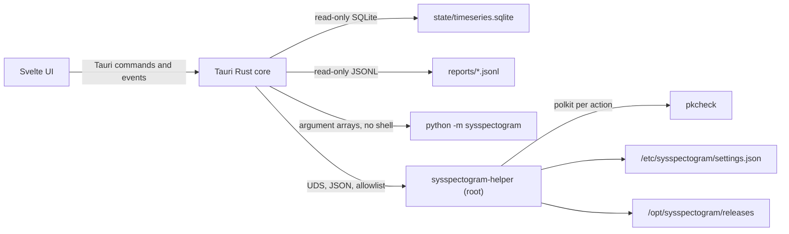

# Control Center

Desktop application for SysSpectogram v1.0, in `control-center/`. Built with Tauri 2 (Rust core) and Svelte 5 + TypeScript (UI). The UI runs as the normal user. Privileged actions go through `sysspectogram-helper` (in `helper/`). See [PRODUCT_v1.0.md](PRODUCT_v1.0.md) and [adr/0004-privilege-helper-split.md](adr/0004-privilege-helper-split.md).

## Boundaries

- The UI has no shell, no filesystem plugin and no direct socket access. Only the fixed Tauri commands are reachable.
- Log reads are limited to a whitelist (`alerts`, `agent`, `perimeter`, `incidents`). Incident ids are checked against `[A-Za-z0-9-]`.
- Lab runs only use registered entries from `sysspectogram/lab_runs.py`. They are localhost-only and never run as root.

## Helper operations (allowlist)

The helper listens on `/run/sysspectogram/helper.sock` (group `sysspectogram`). The caller is identified with `SO_PEERCRED`. Mutating operations are checked with `pkcheck` for the caller's PID and start time.

| Operation | What it does | polkit action |
| --- | --- | --- |
| `status` | `systemctl is-active sysspectogram-guard.service` | none (read-only) |
| `service` | `start`, `stop` or `restart` of the guard unit | `org.sysspectogram.helper.service` |
| `bundle.install` | verifies a signed bundle and installs it | `org.sysspectogram.helper.bundle-install` |
| `settings.apply` | validates keys and values, writes the overlay, keeps a backup | `org.sysspectogram.helper.settings` |
| `settings.rollback` | swaps the overlay with its backup | `org.sysspectogram.helper.settings` |

Any other operation name returns an error. Settings keys must be in the helper allowlist (it mirrors `configs/schema.yaml`).

### Bundle install

1. The caller passes a version (`X.Y.Z`) and a folder it owns. The helper checks the path (absolute, no `..`, owned by the caller).
2. It copies `MANIFEST.sha256` and `MANIFEST.sha256.minisig` into a root-only staging directory and verifies the signature with `minisign` against `/usr/share/sysspectogram/minisign.pub`.
3. Only then does it read the manifest. Each listed file is copied into staging and its sha256 is checked. File names must match `[A-Za-z0-9._-]+`.
4. The files go to `/opt/sysspectogram/releases/X.Y.Z`. The agent binary goes to `/usr/local/sbin/sysspectogram-agent`. `/opt/sysspectogram/current` is switched by an atomic symlink rename.

Verification happens on root-owned copies, so the user cannot change files between the check and the install.

## Settings overlay

The helper writes `/etc/sysspectogram/settings.json` (a flat JSON object of dotted keys). `sysspectogram/config.py` merges it on top of `configs/default.yaml` at load time, but only when the file is owned by root and not writable by group or others. Only keys in `OVERLAY_ALLOWED` are applied; a test keeps that list equal to the helper allowlist and `configs/schema.yaml`. A malformed or untrusted overlay is ignored, so the guard still starts. The previous state is kept in `settings.json.bak` and `settings.rollback` swaps the two files.

## First run and updates

From v1.1 the Control Center can install the stack from a signed GitHub release (Bootstrap / Update stack): wheel + musl agent with sha256 and optional minisign when the `minisign` binary is present. A local signed bundle folder install remains available for air-gapped use.

## Sidebar

| Section | Purpose |
| --- | --- |
| Overview | Guard and helper state, version, host risk for the last hour, latest incidents |
| Live | Latest samples, 5-minute chart; values older than 10 s are marked stale |
| Dashboards | Metrics for 1 h, 6 h, 12 h, 24 h, 7 d and 30 d from the timeseries store |
| Incidents | List, timeline, entities, ATT&CK techniques, HTML or Markdown report |
| Agent | Agent mode, half-life, spectrogram flag, agent score chart |
| Perimeter | Recent `perimeter.jsonl` alerts |
| Settings | Schema-driven editor, pending-changes diff in the selected language, apply, rollback |
| Scenarios | Protection presets with a preview of the changes before applying |
| Tests and Lab | Registered localhost lab runs, streamed output, check for the expected alert |
| Install and Updates | Guard start, stop and restart, bundle install |
| Logs and Audit | Tail of the JSONL reports |
| About and Docs | Version, project root, helper socket, documentation list |

Icons are SVG files in `control-center/src/assets/icons/`: 24 px grid, stroke 1.5, colour through `currentColor`. No icon fonts and no emoji.

## Timeseries

`sysspectogram/timeseries/store.py` writes per-second samples from the guard (`cpu_percent`, `mem_percent`, `swap_percent`, network and disk rates, `gpu_util_percent`) and per-inference values (`host_score`, `host_risk`, `agent_score`, `threshold`). Rollups run once a minute.

| Level | Resolution | Kept for | Used by ranges |
| --- | --- | --- | --- |
| raw | 1 s | 1 h | 1 h |
| r10s | 10 s | 12 h | 6 h, 12 h |
| r1m | 60 s | 7 d | 24 h, 7 d |
| r5m | 300 s | 30 d | 30 d |

The Tauri core opens the database read-only and emits a `live` event every 2 seconds. The store is enabled by `timeseries.enabled` in the config.

## Settings and i18n

- `configs/schema.yaml`: each setting has `title` and `description` in `en` and `ru`, a type, a range or choices, and a `restart` flag where needed.
- `python -m sysspectogram settings export` gives the UI the schema, the current values (with the overlay applied) and the scenarios.
- `python -m sysspectogram settings check` (and `scripts/check_settings_i18n.py`) fail if a text is empty, a default differs from `configs/default.yaml`, or a scenario is invalid.
- The UI strings live in `control-center/src/lib/i18n.ts`. `i18n.test.ts` checks that every key has `en` and `ru`.
- English is the default language. The language switch is in the sidebar and is stored in local storage.

## Scenarios

Presets in `configs/scenarios/`:

- `ssh-server-vps`: userspace agent, observe mode, console unlock required.
- `web-server`: observe mode, slightly looser risk threshold, 10 s inference interval.
- `workstation`: observe mode, looser risk threshold, 10 s inference interval.
- `lab-demo`: hypervisor cross-check with the mock backend, lab trust label. Not for production hosts.
- `hardened-observe`: observe mode only, event spectrogram and VMI off.

## CLI parity matrix

Every top-level subcommand of `python -m sysspectogram` has a row. `scripts/check_cli_parity.py` fails CI when a subcommand is missing from this table or a row no longer matches a subcommand.

| Subcommand | UI | Notes |
| --- | --- | --- |
| `collect` | Tests and Lab | Recording for datasets |
| `build-dataset` | Tests and Lab | |
| `train` | Tests and Lab | Long job |
| `export-onnx` | Tests and Lab | |
| `monitor` | Live | |
| `analyze` | Tests and Lab | Offline CSV analysis |
| `audit` | Overview | Processes, ports, host snapshot |
| `simulate` | Tests and Lab | Localhost only, through `lab run` |
| `watch-perimeter` | Perimeter | |
| `recon` | Perimeter | Requires confirmation |
| `supply-chain` | Install and Updates | Manifest, sign, SBOM, verify |
| `guard` | Install and Updates | Start, stop and restart go through the helper |
| `train-agent-if` | Agent | |
| `profiles` | Scenarios | List, pack, pull, install |
| `data` | cli-only | Train bridge between VPS and PC; needs SSH and file transfer |
| `artifacts` | cli-only | Pushes artifacts to a remote host over SSH |
| `setup` | cli-only | Legacy; replaced by Settings and Install and Updates |
| `configure` | Settings | Day-0 terminal wizard |
| `labels` | Incidents | Process label rules |
| `kirk` | Agent | Trust probe |
| `role-lab` | Scenarios | Role baselines |
| `feedback` | Incidents | Status and retrain |
| `web` | cli-only | Legacy web dashboard; the Control Center replaces it for desktop use |
| `lab-nmap` | Tests and Lab | Allowlisted lab targets only |
| `incidents` | Incidents | List, show, report (the UI calls `incidents report`) |
| `spectro` | Incidents | Metrics spectrogram for an incident or a time: `spectro --incident ID --out x.png` or `spectro --at UNIX_TS --out x.png` |
| `lab` | Tests and Lab | `lab list --json`, `lab run ID` |
| `scenario` | Scenarios | `scenario list`, `scenario show ID --lang en` (or `ru`) |
| `settings` | Settings | `settings export` (UI), `settings check` (CI) |
| `timeseries` | Dashboards | `timeseries query METRIC --range 1h` for scripts |
| `control` | Home / Alerts | Local SOAR over `state/control.sock` (`status`, ban/allow/mute/kill after unlock) |
| `home` | Settings / Home | Onboarding, `.env`, model import, health/digest/checklist, user-settings overlay, `home update` |
| `protect` | Home / Onboarding | User systemd unit (real mode); Start + finish enable it |
| `menu` | cli-only | Friend interactive menu for VPS/SSH (zapret-like) |
| helper release install | Settings | `install-helper-from-release.sh` / `install_helper_release` (no git) |

## Non-goals for v1.0

Multi-host management, remote control over the internet, mobile UI, Windows and macOS builds.
