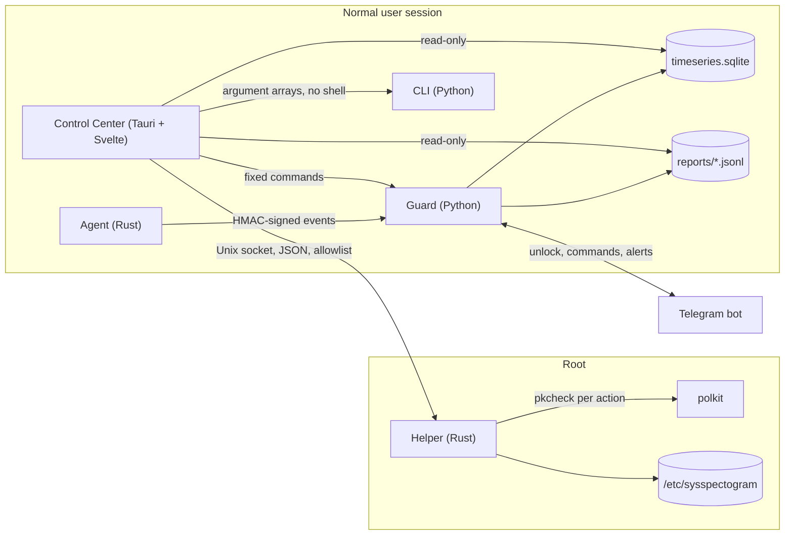

# SysSpectogram 1.0 — Product Description

SysSpectogram is a host defense utility for Linux servers and workstations. It watches a single machine, explains what it sees in plain language, groups related signals into incidents, and lets the operator decide what to do about them. It is local-first: it runs on your host, keeps its data on your host, and never needs a cloud service to work.

This document describes the product as shipped in version 1.0.0: what it does, how it is built, how to operate it, what it protects against, and what it does not do yet. For install steps see the [README](../README.md). For the desktop app see [Control Center](CONTROL_CENTER.md). For release notes and the test record see [RELEASE_v1.0.0.md](RELEASE_v1.0.0.md).

---

## 1. Who it is for

- **Operators of small Linux servers and VPS** who want to know what is happening on the box without running a SIEM.
- **Power users and workstation owners** who run services, containers or GPU workloads and want to notice unexpected activity.
- **Security-minded engineers** who want a readable, scriptable tool with a small, auditable privileged part.

It is not an enterprise EDR, a managed service, or a replacement for patching, backups, or a firewall policy.

## 2. The problem it addresses

A typical host produces thousands of events per minute: process starts, network connections, file changes, logins, load spikes. Most are normal. The hard part is:

1. noticing the few that are not,
2. understanding why an alert fired without reading raw logs,
3. seeing related alerts together instead of as a flood,
4. responding safely, without breaking the machine.

SysSpectogram addresses each of these:

| Problem | What SysSpectogram does |
| --- | --- |
| Too many raw signals | Metrics are turned into per-second rates and scored; agent events are grouped into bursts. |
| Alerts without context | Every alert has a plain-language title, what happened, the raw detail, and a suggested action. Spectrograms show the metrics around the event. |
| Flood of related alerts | The incident engine correlates alerts that share a process, path, address or time window into one incident. |
| Fear of automated damage | Enforcement is off by default. The Control Center runs the guard in observe mode and every destructive action needs an explicit operator confirmation. |

## 3. What is in the box

SysSpectogram 1.0 is made of five parts:

| Part | Language | Role |
| --- | --- | --- |
| **Guard** (`python -m sysspectogram guard`) | Python | The long-running monitor: collects host metrics, scores them, watches the perimeter, runs the agent, sends Telegram alerts, and hosts the Telegram control plane. |
| **Agent** (`agent/`, `sysspectogram-agent`) | Rust | Sensor for process starts, file integrity, path access, kernel module loads, network bursts and root escalation. Optional eBPF mode. Reports to the guard over a local socket with HMAC-signed messages. |
| **Helper** (`helper/`, `sysspectogram-helper`) | Rust | The only component that runs as root. Accepts a fixed list of operations over a Unix socket, checks polkit for every change, and nothing else. |
| **Control Center** (`control-center/`) | Rust (Tauri 2) + Svelte 5 | Desktop application: overview, live view, dashboards, incidents, settings, scenarios, lab runs, logs, install and updates. Runs as the normal user. |
| **CLI** (`python -m sysspectogram …`) | Python | Everything the app does is also a CLI command (parity is tested). Scripts and CI use the same commands. |

## 4. Capabilities

### 4.1 Host telemetry and dashboards

- Per-second collection of CPU, memory, swap, network, disk, GPU utilisation and GPU memory, plus socket and scheduler counters.
- Metrics are stored in a local SQLite time-series store with automatic roll-ups:

  | Resolution | Kept for |
  | --- | --- |
  | 1 s (raw) | 1 hour |
  | 10 s | 12 hours |
  | 1 min | 7 days |
  | 5 min | 30 days |

- The Control Center shows the **Live** view (latest samples, marked stale when older than 10 s) and **Dashboards** for 1 h, 6 h, 12 h, 24 h, 7 d and 30 d.
- A time-series query is also available from the CLI: `python -m sysspectogram timeseries query METRIC --range 1h`.

### 4.2 Detection

SysSpectogram detects with several independent sources. Each source has its own alerts and its own limits.

**Agent (process, file and kernel signals)**

- Process execution bursts and suspicious execution patterns (eBPF `execve` in eBPF mode).
- File integrity monitoring (FIM): hashes of watched system binaries, with alerts on change.
- Path watch: access to protected paths.
- Kernel module load and delete events.
- Outbound connection bursts per process.
- Unexpected privilege escalation to root.
- Guard liveness: if the guard process disappears without a clean stop, the agent raises a critical alert.

**Perimeter (network and authentication)**

- Authentication brute-force attempts.
- Inbound port scans.
- Unusual egress and DNS activity.
- Optional honeypot and canary files.

**Host machine-learning monitor (experimental)**

- A small CNN over a 60-second metric "spectrogram" and an Isolation Forest over the same window, fused into one host risk score.
- **Status: experimental.** The default runtime is `notorch`, which runs the agent and perimeter signals and the metric feed without the host CNN. Offline measurements on the bundled validation set did not show a useful separation (see section 8). Do not treat host ML scores as reliable detections in 1.0.

**Kernel integrity signals (KIRK, in-guest)**

- Integrity probes for kernel symbols and module state, reported with explicit trust labels. These are signals, not a rootkit verdict. See [KIRK.md](KIRK.md).

**VMI cross-view (read-only, lab only)**

- Compares a guest's task list as seen from outside the guest with the list the guest reports. Requires self-hosted KVM and a separate trust domain. Shipped with a mock backend; the libvmi backend is not verified on hardware in 1.0. See [VMI.md](VMI.md).

### 4.3 Incidents

- Alerts from the agent, the perimeter and the guard are normalised into one schema (`incident.v1`).
- Alerts that share an entity (process id, command name, path or address) inside a 300-second window are grouped into one incident. Union-find grouping keeps chains together.
- Each incident has: id, severity, first and last time, duration, event count, entities, timeline, a reason, and best-effort MITRE ATT&CK technique mapping.
- Reports: self-contained HTML (with an embedded spectrogram when one is available) and Markdown. HTML output is escaped.
- Incident list is rebuilt from the logs when you open the Incidents screen or press Refresh.
- **Spectrogram on demand:** in the Incidents screen, "Spectrogram" renders the metrics for the two minutes before the incident through its end. Nothing is written to disk or sent anywhere.

CLI: `python -m sysspectogram incidents list|show|report` and `python -m sysspectogram spectro --incident ID --out file.png`.

### 4.4 Alerts and Telegram

- Alerts are written as JSON lines in `reports/` and shown in the Logs screen.
- Telegram receives alerts with a readable structure:
  - a severity-tagged title,
  - **What happened** in plain language,
  - **Details** with the raw message,
  - the process or object involved,
  - **What to do** with a concrete next step,
  - a line stating whether anything was enforced (in observe mode: nothing).
- Where a metric window is available, the alert is sent as a photo with the spectrogram.
- Connection bursts that cannot be attributed to a process (pid 0) are kept in the local log and are not sent to Telegram, because they are usually noise.
- **Control plane:** the bot accepts commands only after the operator unlocks it on the host. A 6-digit pairing code is generated when the guard starts, shown in the Control Center on request for 20 seconds, and deleted when pairing succeeds or the guard stops cleanly. The unlock lasts 2 hours by default (`telegram.unlock_ttl_sec`). After five wrong codes a new code is issued; more than eight attempts within five minutes are refused.

### 4.5 Response

- Default: **observe**. The guard detects and reports; it does not block traffic or stop processes.
- The Control Center always starts the guard with `--dry-run`: actions are simulated and logged.
- Optional response (operator-enabled in configuration): firewall bans through nftables with a time-to-live, and process termination requested from Telegram with a confirmation step. Process kills from Telegram are checked against the process name recorded when the button was created, so a reused pid is not killed by mistake.
- Response actions are shown in the guard log and in the alert that announced them; the Telegram alert always states whether anything was enforced.

### 4.6 Settings

- Settings are described in one schema (`configs/schema.yaml`). The UI, the validator and the CI check all read the same file.
- The Control Center's Settings screen validates values, shows a diff with an explanation of each change, and says which changes need a restart.
- Apply goes through the helper. The previous configuration is kept, and one step of rollback is available.
- Changes are stored in a root-owned overlay (`/etc/sysspectogram/settings.json`). Only allowlisted keys are applied. An overlay that is not root-owned, or not private, is ignored.

### 4.7 Scenarios (presets)

Ten presets in `configs/scenarios/` are overrides on top of the default configuration for a common role. Each one sets the keys it needs (for example the agent mode and the alert thresholds):

`workstation`, `ssh-server-vps`, `web-server`, `nginx-web`, `docker-host`, `database-server`, `vps-large`, `dedicated-large`, `hardened-observe`, `lab-demo`.

Each preset can choose the agent mode: **eBPF** (kernel events, needs capabilities) or **userspace** (no special capabilities, less coverage). The Scenarios screen lets you pick the mode when you apply a preset.

### 4.8 Lab (testing detections without harm)

- The Tests and Lab screen runs registered simulations: `cpu`, `mem`, `disk`, `net`, `gpu`, `gpu-mem` load, plus a few scripted lab cases.
- Simulations are localhost-only and never run as root.
- After a run the lab checks whether the expected alert appeared in the reports.
- Lab runs are the supported way to confirm that a detection path works on your machine.

### 4.9 Install and updates

- The helper is installed once by `scripts/install-helper.sh` (root). It places the binary, the systemd unit, the polkit policy and the system user entry.
- Signed bundles: the bundle manifest is verified with minisign against a public key in `/usr/share/sysspectogram/`, then each file is checked by sha256 in a root-owned staging area, then the release directory is activated by an atomic symlink switch.
- Version 1.0 installs from a local folder. Automatic download of releases is not implemented yet.

## 5. Architecture

Design rules that shape the code:

- **Least privilege.** Only the helper runs as root, and it exposes five operations. The UI has no shell, no direct socket access and no general file access.
- **Verified updates.** Privileged installs check a signature before any file is read, and then check every file hash on root-owned copies, so the user cannot swap files between check and install.
- **Explainable output.** Alerts state what happened and what to do, and the spectrogram shows the metrics around the event.
- **Honest trust labels.** Signals from inside the guest are labelled as such. Out-of-band checks (VMI) are labelled as lab-only until verified.
- **One source of truth.** Settings, the CLI, the UI and CI checks share the schema. A parity test fails when a CLI command is not documented.

Security boundaries and what each boundary protects against are described in [THREAT_MODEL.md](THREAT_MODEL.md).

## 6. Typical workflow

1. **Install** the CLI package and the helper (`scripts/install-helper.sh`), then start the Control Center.
2. **Choose a scenario** that matches the machine (Scenarios screen). Keep the observe mode for the first days.
3. **Start the stack** with "Start everything" on Overview. The helper starts through polkit (one password prompt); the guard starts in observe mode.
4. **Watch the baseline** on Live and Dashboards for a day. Note what is normal for this machine.
5. **Read incidents.** Open Incidents, read the reason and timeline, open the spectrogram, and decide: ignore, document, or act.
6. **Connect Telegram** if you want alerts on your phone: fill `.env`, then unlock the bot from Overview with the displayed pairing code.
7. **Test** a few detections with the Lab screen before trusting silence.
8. **Tune** through Settings: change thresholds one at a time, read the diff, apply, and roll back if needed.

## 7. Requirements

- Linux with systemd. Tested on Arch Linux with kernel 7.x and NVIDIA GPU; other distributions are expected to work but are not the primary target in 1.0.
- Python 3.10 or newer. Torch is optional: the default runtime does not need it.
- Rust stable for the agent and helper. Node.js 20+ and the Tauri 2 system libraries (webkit2gtk-4.1 on Arch) for the Control Center build.
- Root access once, for the helper install and the optional eBPF setup.
- Optional: KVM and libvmi for the VMI lab; clang and the eBPF toolchain for eBPF mode; minisign for bundle verification.

## 8. Measured quality (honest status)

The offline evaluation (`scripts/eval_offline.py`, validation split of `dataset/real`: 187 windows, 139 normal and 48 anomaly) gives these results in `docs/EVAL.md`:

| Method | Precision | Recall | F1 | False-positive rate |
| --- | ---: | ---: | ---: | ---: |
| zscore baseline | 0.29 | 0.96 | 0.45 | 0.80 |
| host CNN | 0.00 | 0.00 | 0.00 | 0.00 |
| Isolation Forest | 0.00 | 0.00 | 0.00 | 0.00 |

What this means:

- The host ML models do not separate normal from anomalous windows on this dataset. They are therefore **experimental** in 1.0 and off in the default runtime.
- The agent and perimeter rules are deterministic. They are measured by the lab scenarios, not by this table.
- SysSpectogram 1.0 makes no claim of a detection rate for any attack. The values above are the only measurements in the repository.

Thresholds were not tuned to improve these numbers. Retraining on a larger labelled set is the next step for the ML path.

## 9. Security model

- **Local only.** The guard and the UI do not open a public port. The optional web view listens on localhost unless you put it behind a reverse proxy with authentication.
- **Telegram** is an optional control plane. It is locked after every guard start until the operator unlocks it on the host. The bot token alone cannot control the host.
- **Secrets** (`.env`, the pairing code file) are created with mode 0600. The pairing code is never written to the log or to Telegram.
- **Helper** accepts only allowlisted operations, identifies the caller with `SO_PEERCRED`, and asks polkit before every change.
- **Settings overlay** is applied only from a root-owned, non-writable-by-others file, and only for allowlisted keys.
- **Agent messages** are authenticated with HMAC; the guard accepts messages only from processes it trusts (pid list and executable seal).
- **Lab** actions are localhost-only and run as the normal user.

What SysSpectogram does not protect against is listed in section 10.

## 10. Limitations and known gaps

These limitations are part of the 1.0 release. They are also listed in [RELEASE_v1.0.0.md](RELEASE_v1.0.0.md).

- **A root attacker on the same host** can stop services, delete logs and tamper with local state. Remote alert sinks and signed bundles make silent changes harder; they do not make the tool unkillable.
- **Kernel rootkits** that hide processes from `/proc` can evade userspace checks. eBPF reduces this blind spot but does not remove it.
- **Host ML** is experimental (section 8).
- **VMI libvmi backend** is not verified on hardware. Keep `kirk.vmi_backend: mock` until it is.
- **Event spectrogram CNN** is off by default and not proven better than the rules.
- **Process history** is not stored, so the lower panel of the spectrogram is empty in 1.0. Only system metrics are plotted.
- **Automatic release download** is not implemented. Install from a local signed bundle.
- **Config change log** (`config_changes.jsonl`) is not implemented. The previous overlay is kept as `settings.json.bak`.
- **File integrity baseline** can produce alerts after package updates. Check with `pacman -Qkk <package>` before acting, and re-baseline after a verified update.
- **Connection bursts** without a process attribution are noisy. They stay in the local log and are not sent to Telegram.
- **Agent socket window**: at startup, the listener accepts datagrams before the agent's pid allowlist is set. The window is short. A fix is planned.
- **Visual verification** of the Control Center binary on every supported distribution is the maintainer's step before each release.
- **Privileged setup** (virtualisation, eBPF capabilities, helper install, signing key) requires root and is documented as explicit steps. The application never performs them silently.

## 11. Glossary

- **Observe mode:** detect and report only; no blocking or killing.
- **Dry run:** actions are evaluated and logged but not executed.
- **Spectrogram:** a time × metric matrix of scaled values. In SysSpectogram it is used both as the CNN input and as a visual snapshot around an event.
- **Incident:** a group of alerts that share an entity inside a time window.
- **Trust label:** a statement of where a signal comes from and how far it can be believed (for example `lab`, `in-guest`).
- **Pairing code:** the 6-digit code that unlocks the Telegram control plane for two hours.

## 12. Versioning and license

- Version: 1.0.0 (`pyproject.toml`, `agent/Cargo.toml`, `control-center/package.json`).
- License: MIT. See [LICENSE](../LICENSE).
- Release history: [RELEASE_v1.0.0.md](RELEASE_v1.0.0.md), [RELEASE_v0.9.0.md](RELEASE_v0.9.0.md), [RELEASE_v0.8.0.md](RELEASE_v0.8.0.md).
- Roadmap and quality plan: [ROADMAP_QUALITY.md](ROADMAP_QUALITY.md).
