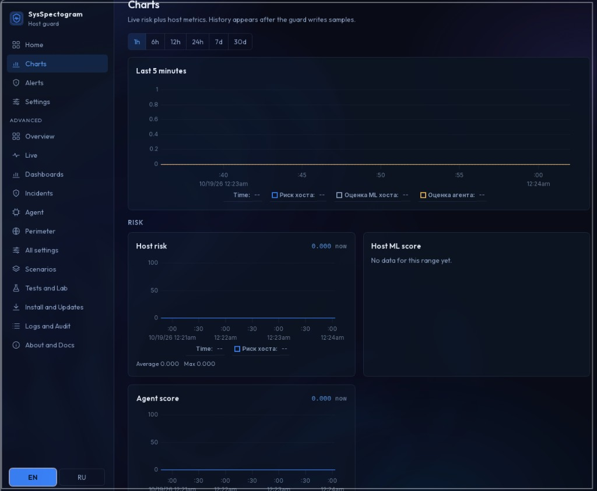
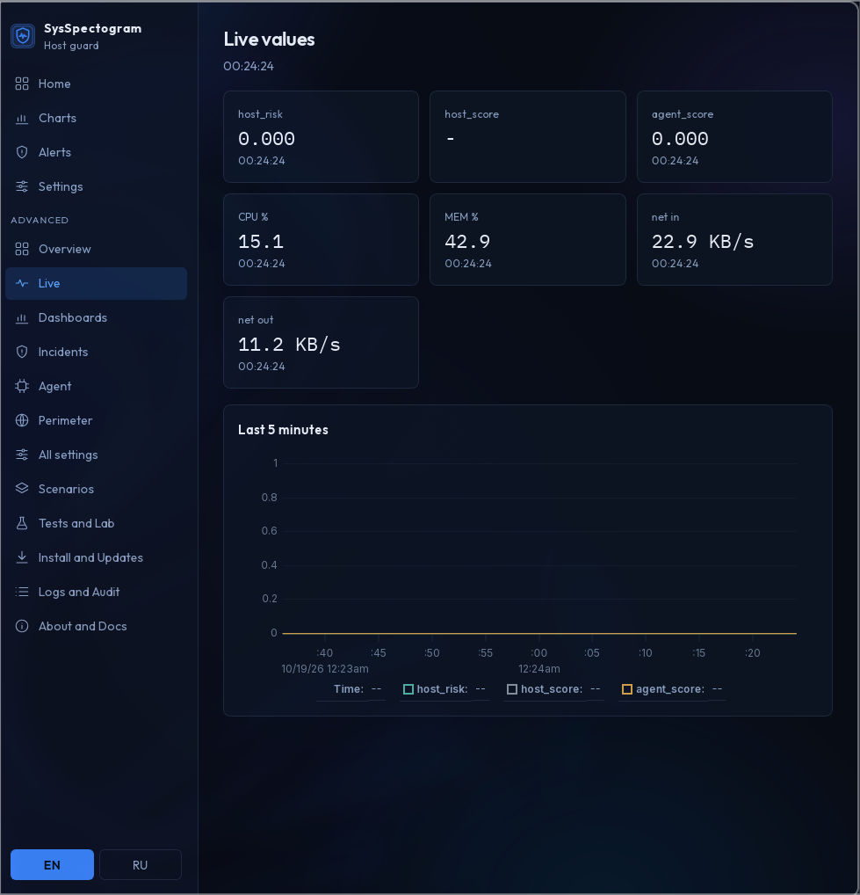
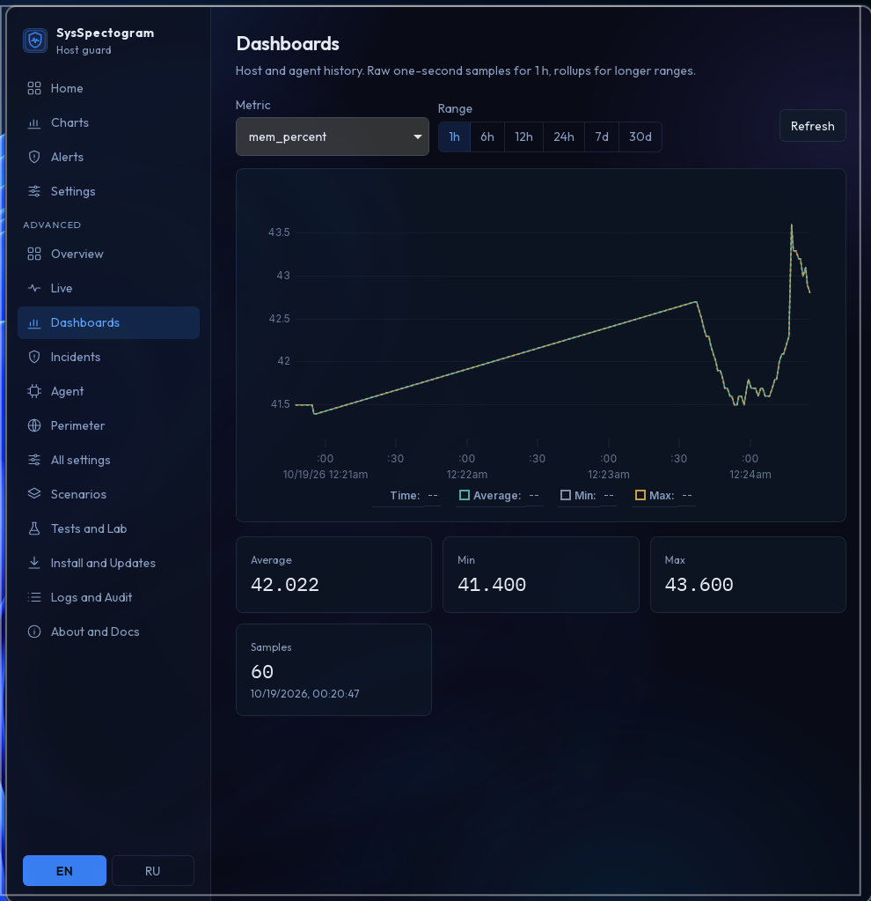
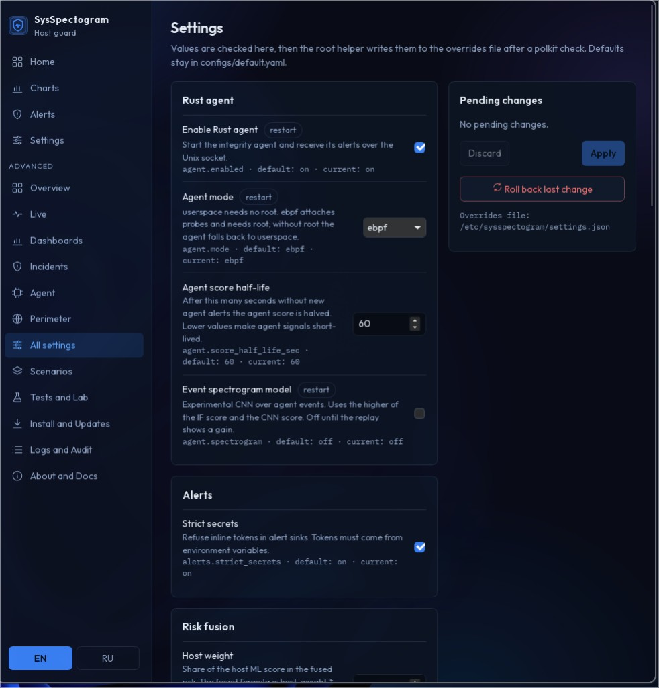
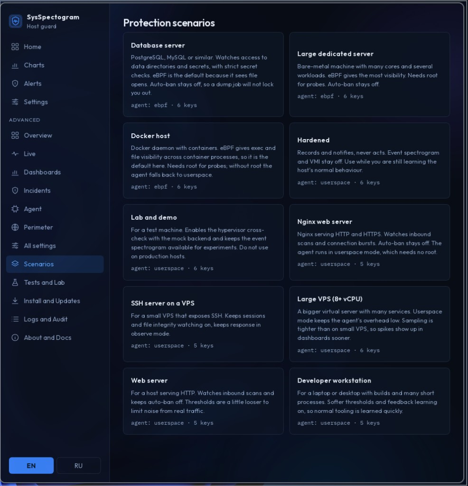
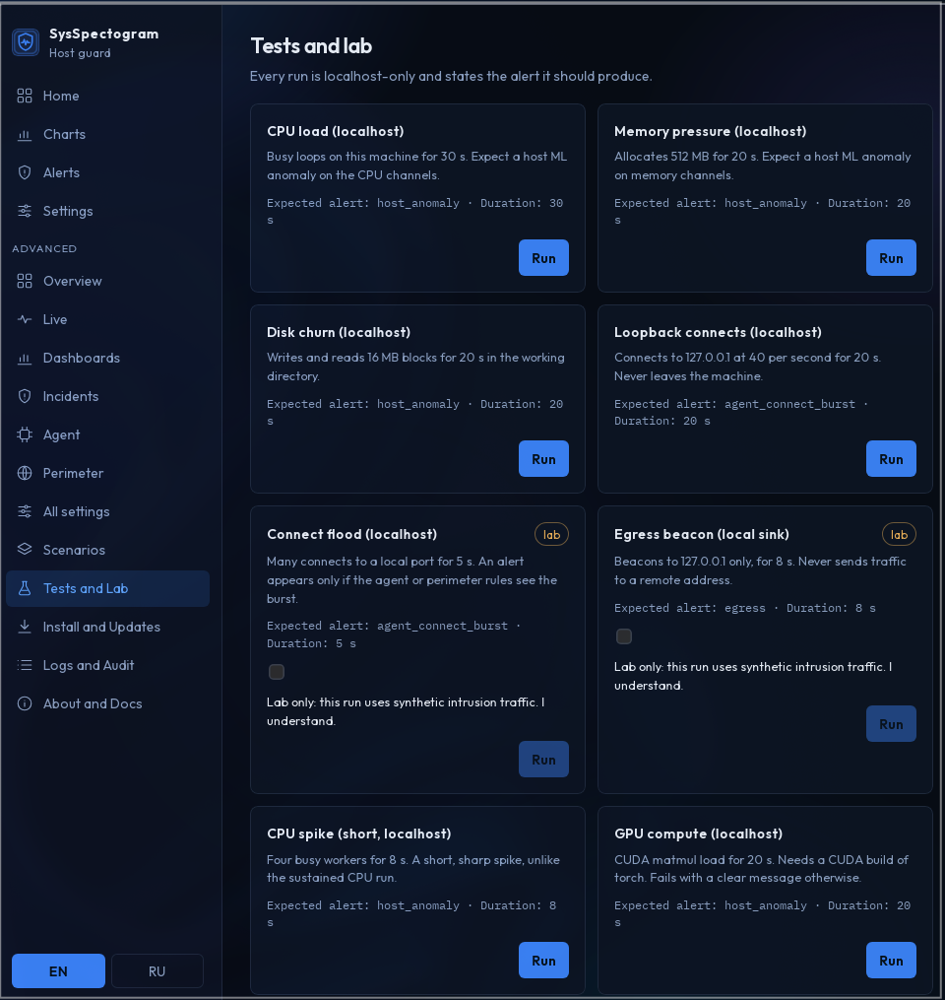

# SysSpectogram v1.1.0 — Simple home + friend packages

Self-hosted host guard for people who rent a small VPS and want clear alerts without living in YAML. Control Center is the primary surface; geek tools stay behind Advanced.

Companion guide: [HOME.md](HOME.md). Screenshots: [`docs/assets/v1.1/`](assets/v1.1/).

## Friend path (AppImage / deb)

No git clone on the VPS ([ADR 0005](adr/0005-signed-bundle-not-git.md)).

1. Download **AppImage** or **`.deb`** from the [GitHub Release](https://github.com/lifeqsoll/SysSpectogram/releases) for this version.
2. Open Control Center. If the Python stack is missing, use **Install stack v1.1.0** — downloads the signed wheel + musl agent for the same tag, verifies **sha256** and **minisign** (pubkey embedded in the app), creates `~/.local/share/sysspectogram/.venv`.
3. Complete onboarding → **Start protection**.
4. Optional: install the privileged helper once (`scripts/install-helper.sh` / Settings) for system overlays; home settings work without it.

Dev checkouts still use the repo root and `.venv` and skip the bootstrap screen.

## Highlights

- **Simple shell by default** — Home, Charts, Alerts, Settings. Advanced unlocks the full geek sidebar.
- **First-run wizard** — language, theme, role, protect mode, Telegram, ML warning; then Start protection.
- **Plain-language alerts (EN/RU)** — Telegram follows `ui.lang` (one language per guard start).
- **Basic settings** — language, theme, Telegram, web, protection mode (`observe` / `shield` / `aggressive` / `isolate`), never-ban CIDRs, ML weight import.
- **Web optional** — `web.enabled: false` by default; charts live in the app.
- **Local control socket** — `state/control.sock` for SOAR from Control Center / CLI.
- **Guard without a hard-coded model** — `artifacts/live` or `state/model.path`, else notorch (perimeter + metrics).

## Home UX (with screens)

### Home — status, tips, health, 24h digest


- Guard / mode / risk / CPU / Telegram at a glance
- **Start protection**, **Health check**, **Ping Telegram**
- Plain-language **Last 24 hours** summary
- **VPS ready checklist** (includes never-ban)

### Charts & Live







Empty graphs were caused by a guard crash on unlock-code write (`os` not imported). Fixed; timeseries fills again within ~30s after **Start protection**.

### Settings — modes + never-ban IP



Protection modes: `observe` · `shield` (soft) · `aggressive` (full) · `isolate`.

**Never-ban CIDRs** (`response.never_ban_cidrs`):

1. Find your public IP: `curl -4 ifconfig.me`
2. **Settings** → Never-ban CIDRs → e.g. `203.0.113.10/32`
3. **Apply** → restart guard

### Scenarios & Lab (Advanced)





## Settings overlay (keys)

| Key | Default | Notes |
| --- | --- | --- |
| `ui.lang` | `en` | Alert + Telegram language |
| `telegram.enabled` | `false` | Also gated by `.env` credentials |
| `web.enabled` | `false` | Restart guard after change |
| `response.mode` | `observe` | `observe`, `shield`, `aggressive`, `isolate` |
| `response.never_ban_cidrs` | `[]` | Comma-separated overlay string or YAML list |

```bash
python -m sysspectogram home settings --changes '{"response.never_ban_cidrs":"203.0.113.10/32"}'
```

## CLI additions

```bash
python -m sysspectogram control status
python -m sysspectogram control ban --ip 203.0.113.10 --ttl 3600
python -m sysspectogram home env --bot-token … --chat-id …
python -m sysspectogram home import-model /path/to/builder/artifacts
python -m sysspectogram home onboarding status|done
python -m sysspectogram home health
python -m sysspectogram home digest
python -m sysspectogram home checklist
```

## Reliability fixes in this release

- Natural Russian Telegram unlock copy; single language per start (no EN+RU double send).
- `agent_kirk_agent_down` uses `alert_text` + startup grace + **30 min** backoff (no raw English every ~180s).
- Failed agent auto-start: one clear alert instead of a heartbeat flood.
- Alerts perimeter log path; mute rule 24h; desktop notifications on high risk.

## Upgrade notes

1. Prefer AppImage/deb from the matching GitHub tag, or rebuild Control Center (`1.1.0`).
2. Restart the guard after changing `ui.lang`, Telegram/web, or `response.mode`.
3. If you previously set `response.mode: enforce`, switch to `shield` or `aggressive`.
4. Set **never-ban** to your `/32` before enabling soft/full auto-ban.
5. Helper rebuild optional if you use system-wide install: `sudo scripts/install-helper.sh …`.

## Out of scope

- Training / metric collection UI on the VPS
- Putting nft/kill into the helper (still guard-owned)
- macOS DMG (Linux AppImage + deb only)

## Verification

- Python: `pytest tests/test_alert_snapshot.py tests/test_control_socket.py tests/test_settings_schema.py`
- Control Center: `cd control-center && npm test`
- Manual: AppImage → Install stack → wizard → Home charts → single-language TG unlock → no agent_down flood when agent is up
